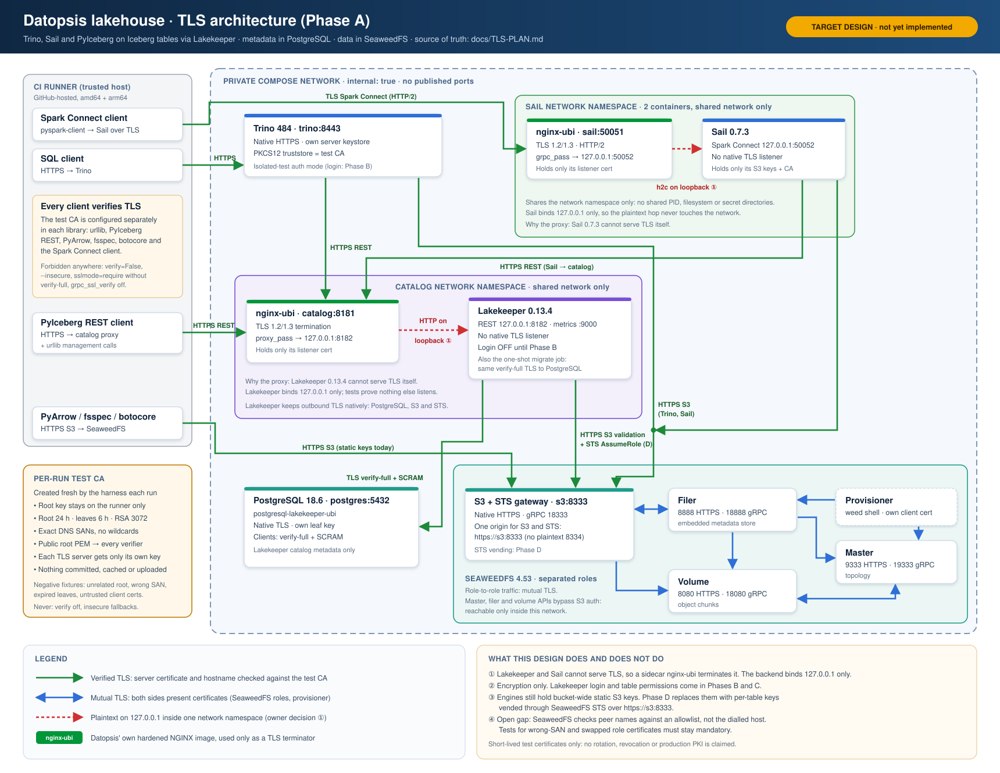
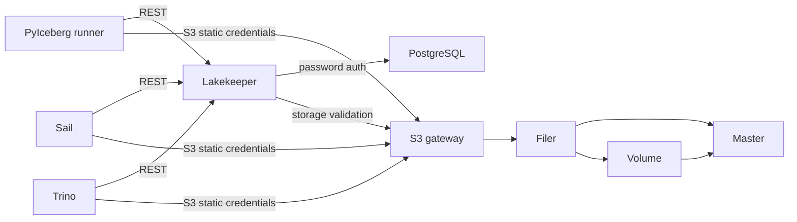
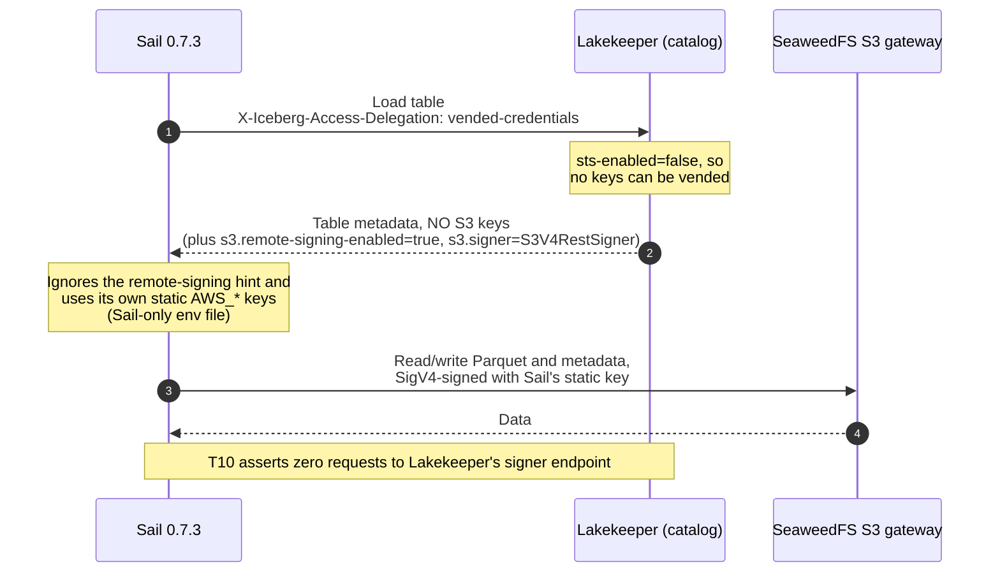

# Architecture

> **Target TLS design (Phase A, not yet implemented):** see the polished diagram below and
> [TLS-PLAN.md](TLS-PLAN.md). The Mermaid chart that follows shows the CURRENT test topology.

All eight long-running containers share one internal network, with zero published
ports. The trusted Linux runner reaches bridge addresses and resolves catalog,
s3, trino, and sail through a temporary marked /etc/hosts block. A short-lived migration
container uses the same hardening and network. Negative-test containers also use
that profile and are explicitly removed. All images are built from images.lock.json
using their owning repository scripts; Podman-built images are exported into the
runtime store and inspected there.

| Role | UID:GID | Internal listeners | Persistent/writable paths | Secret delivery |
| --- | --- | --- | --- | --- |
| PostgreSQL | 26:0 | 5432 | pg-data at /var/lib/pgsql; /tmp tmpfs | PostgreSQL-only directory: admin and Lakekeeper passwords |
| Lakekeeper / migrate | 999:0 | 8181 API, 9000 metrics (serve) | none | Lakekeeper-only env file: database URL/password and encryption key |
| Seaweed master | 1000:0 | 9333, 19333 gRPC | master-data at /data | none |
| Seaweed volume | 1000:0 | 8080, 18080 gRPC | volume-data at /data | none |
| Seaweed filer | 1000:0 | 8888, 18888 gRPC | filer-data at /data (embedded store) | none |
| Seaweed S3 | 1000:0 | 8333, 18333 gRPC | none | S3-only directory with s3.json |
| Trino | 10001:0 | 8080 | /var/lib/trino tmpfs; executable /tmp/trino tmpfs for native libraries | Trino-only env file with static S3 keys |
| Sail | 10001:10001 | 50051 Spark Connect | /tmp and /var/lib/sail tmpfs (noexec) | Sail-only env file with static AWS keys; read-only listener JSON |

Sail is defined in `integration/compose.sail.yaml`, always composed with the base
file for startup, recreation, diagnostics and teardown. Its separate probe/client
modules keep Spark dependencies out of the PyIceberg environment. T10 uses fresh
Spark sessions and fresh PyIceberg processes at every mutation boundary. Passive
HTTP capture provides evidence of the hard-coded vending header, Lakekeeper's
response and the credential used to sign S3; only redacted text is uploaded.

Ports are internal configuration, not published host listeners. All roots are
read-only; every service drops ALL capabilities and sets no-new-privileges.
Tmpfs has nosuid/nodev; data tmpfs is noexec. Trino native libraries require the
explicit executable temp exception. Seaweed's 64 MiB volume size and four-volume
limit bound the test fixture, not production capacity.

The S3 fixture identity has Read:warehouse, Write:warehouse, List:warehouse.
[The pinned SeaweedFS authorization implementation](https://github.com/seaweedfs/seaweedfs/blob/4ab66fb76da83700739f5839e62fcaf15fb7d02a/weed/s3api/auth_credentials.go)
supports bucket-scoped actions. Admin/Tagging are not granted. A trusted weed
shell precreates the bucket. PostgreSQL stores catalog rows and encrypted S3
credentials; SeaweedFS stores Iceberg metadata JSON, manifests, Parquet data and
positional deletes. Trino/PyIceberg table locations are assigned by Lakekeeper;
Sail proposes `s3://warehouse/from_sail`, which Lakekeeper registers in that same warehouse.

Trust boundaries: service file mounts limit accidental cross-service secret
exposure; they do not isolate an already-compromised network member from the
unauthenticated Lakekeeper or Seaweed control APIs. Host/runner access is fully
trusted. Lakekeeper login off and plaintext internal traffic are known test-only
gaps. Trino uses TRINO_UBI_ALLOW_INSECURE=true, vending is disabled, and PyIceberg
explicitly selects client-managed credentials. Sail 0.7.3 requests vending, receives
remote-signing properties without keys, and uses its own static AWS environment
credentials successfully. The [T10 capture](SAIL-EVIDENCE.md) observes no signer
requests; the gate rejects any such request. No remote signer is needed on the main path.
T9 separately exercises a no-key remote-signing client and records the known
concurrent signer-registration race; see [the draft report](known-issues/remote-signing.md).

### How each engine gets S3 access

Lakekeeper's storage profile has `sts-enabled: false`, so the catalog can never hand
out S3 keys. Every engine therefore signs S3 requests with its own static keys. Trino
and PyIceberg choose this explicitly. Sail 0.7.3 asks for vended credentials (it
cannot be configured not to) and falls back to its own keys when none come back:

| Client | What it asks the catalog for | What it actually signs S3 requests with |
| --- | --- | --- |
| Trino | Nothing (`vended-credentials-enabled=false`) | Its own static keys |
| PyIceberg | `client-managed` | Its own static keys |
| Sail 0.7.3 | `vended-credentials` (hard-coded) | Its own static keys, because none are vended |

**Caveat: static keys bypass catalog authorization.** Each engine's S3 identity can
read and write the whole `warehouse` bucket (Read/Write/List). The catalog decides
which tables an engine can *find*, not which objects it can *read*. Today that changes
nothing, because Lakekeeper login is off and every caller is allowed everything. Once
OpenID login and table permissions are added (see the roadmap), those permissions will
NOT protect the data while engines hold bucket-wide static keys: an engine can read
any table's files directly from S3. For catalog permissions to be enforced on data,
the catalog must grant the S3 access itself, per table and short-lived. Lakekeeper
offers two ways, and on SeaweedFS only one of them isolates tables:

- **Credential vending (the chosen path).** Lakekeeper calls SeaweedFS's STS
  `AssumeRole` with a session policy limited to the table's location and hands the
  engine short-lived keys. STS exists in SeaweedFS 4.53 but is being qualified in
  `seaweedfs-ubi` (owner approval 2026-11-11, subject to adversarial tests).
- **Remote signing (not a table-isolation control on SeaweedFS).** Lakekeeper's own
  [storage documentation](https://github.com/lakekeeper/lakekeeper/blob/main/docs/docs/storage.md)
  states that SeaweedFS does not check every part of a signed request, so a client can
  alter a signed request to reach another table's files, and recommends vended
  credentials for SeaweedFS. Trino 484 also does not support it, and PyIceberg has the
  concurrency bug that T9 records. `seaweedfs-ubi` documents how to use it and its limits.

This switch is part of the security phases (TLS, OpenID, authorization, then
catalog-controlled data access). Also, when Sail is upgraded to
a release with configurable delegation (upstream commit `0c8333a`), set
`access_delegation` explicitly so this behaviour is a decision, not a fallback.

T5 removes containers/network using compose down without --volumes, then creates
a new stack. The four volumes and generated keys survive. Every nonempty container
ID must change; a fresh Python process reads all tables and validates a new write.
The encoding canary retains its exact decoder expectation across restart. Final
cleanup destroys volumes and restores the marked hosts block. This is graceful
recreation, not crash, power-loss, replication, or host-loss durability evidence.

Sail 0.7.3 mutations use explicit copy-on-write on an unpartitioned table. T10
requires no delete files from these mutations and distinct committed snapshots,
without imposing Trino's snapshot sequence on Sail. Sail also reads Trino's
mutated files with the adopted delta-length encoding setting. The separate
default-encoding canary stays mandatory. T5 checks Sail's new container ID,
rereads all four tables and verifies a new Sail write with both other clients.
Sail's own unauthenticated remote-listener opt-out is another private-test gap.

T8 follows T5 on the same private fixture. It creates a dedicated Iceberg v2 /
Parquet table and journals three successful 16-row INSERTs on the runner. One
`docker kill --signal=KILL` invocation targets all eight service IDs; every target
must stop with exit code 137. `compose start` reuses the same containers and named
volumes. Both Trino and a fresh PyIceberg process must read all 48 exact rows and
exactly four append snapshots (one empty CREATE plus three INSERTs) with matching IDs and parents.

Next, separate tables exercise PostgreSQL, Lakekeeper (`catalog`), SeaweedFS
`volume`, and `filer` in that order. A continuous writer assigns every INSERT a
unique batch ID and 16 deterministic rows. After at least two acknowledgements,
the injector polls Trino query state independently of the writer until it
observes RUNNING, then kills and starts that component while the loop continues.
Polling query state avoids missing short queries between statement response
pages. This targets an active workload, not a guaranteed storage-instruction
boundary. Even if the server finishes before the signal arrives, every client
acknowledgement is binding. The test fails if it cannot observe a RUNNING INSERT.

The runner flushes the attempt/acknowledgement journal outside the killed
containers. A failed client statement is ambiguous: after it reaches a terminal
state (or is explicitly cancelled and confirmed terminal), its entire batch may
be present or absent. No query is left running when rows are checked. Unknown
submissions that cannot be settled fail closed. Exact batch comparison rejects
partial, duplicate, unexpected or changed rows; every acknowledged batch is
mandatory. The snapshot count must equal one creation snapshot plus the number of fully
visible batches; the original empty creation snapshot must survive unchanged. All operations must be append, and the parent chain and current snapshot must
match. Both clients must agree on rows and snapshot metadata.

A new INSERT started after component restart must succeed. Recovery time is
measured from the kill command through that write and fresh-process verification
of all tables, with a 180-second component bound. Only readiness and workload
operations retry; durability assertions run once. Earlier tables and settled
in-flight outcomes are rechecked after every later kill. The existing encoding
canary keeps its exact decoder contract; no crash table has an encoding exemption.
Artifacts include the JSONL journal, reader logs and per-scenario results.

This is **single-host container-kill** testing. A container SIGKILL is not a host
power loss: the host page cache can survive. There is no fsync or disk-cache
qualification, no host-loss or replication evidence, and no claim of exhaustive
crash timing coverage. Real power-loss and host-loss tests remain on the roadmap.

## Native architecture gate

The owner superseded the initial amd64-only scope on 2026-11-11. One workflow
matrix runs the complete fixture in parallel on native GitHub-hosted Linux
`ubuntu-24.04` (amd64) and `ubuntu-24.04-arm` (arm64). `uname -m` must be `x86_64`
and `aarch64`, respectively. The build driver independently validates the native
Linux host and rejects a different requested architecture. No QEMU or emulation
is installed or used. Runtime tests and their assertions are identical.

Both jobs read the same `images.lock.json` and fetch the same full source SHAs.
Repository-owned build commands receive the native architecture; PostgreSQL's
build script detects it itself. Its provenance hash uses
`artifacts/locks/amd64.json` or `artifacts/locks/arm64.json`. Lakekeeper, SeaweedFS,
and Trino hash their shared `artifacts/<service>.lock.json` files and select the
native architecture's artifacts. Sail's shared Sail/RPM lock pair is hashed in
owner-defined order and its build receives the same verified native architecture.
Extracted Lakekeeper/SeaweedFS binary hashes
must also match that architecture's lock entry. The pinned cosign helper is
selected and checked for the native architecture before extracting its binary.
Every loaded image must have matching OCI architecture metadata, source revision,
and artifact-lock SHA-256. Missing or mismatched evidence fails without exceptions.

`Integration (amd64)` and `Integration (arm64)` retain separate sanitized artifacts.
Fail-fast is disabled so a failing architecture does not cancel the other. The
final required job is named exactly `Integration`: its matrix dependency waits
for both jobs, and its always-run success assertion rejects failure, cancellation
and skipping. The scheduled issue job depends on this aggregate and the unchanged
read-only upstream report, so either architecture's failure opens/updates the
existing weekly issue. Each job's Actions timestamps provide wall time and runner
minutes; sum runner durations for consumption, not overlapping elapsed wall time.

## T12 schema evolution and time travel

`integration/evolution.py` creates an Iceberg v2/Parquet table through Trino 484
and Lakekeeper with integer `id`, string `label`/`obsolete`, and `details` containing
integer `code`. It adds `note`, renames `label` to `title`, drops `obsolete`, widens
`id` to bigint, and adds nested `details.extra`. Each DDL is followed by exact
schema and row checks before any new write, then an INSERT and another exact
check. Old rows must have null new fields and retain their renamed values. The
wide INSERT uses 2147483648, beyond signed integer range. The nested INSERT carries
a non-null new field. PyIceberg also asserts field IDs and optionality: rename
and widening preserve identity; additions get new IDs. Schema-only commits must
not create data snapshots.

Six acknowledged data snapshots capture the original schema and each evolution
step. After all changes, Trino `FOR VERSION AS OF` and `FOR TIMESTAMP AS OF` must
return each snapshot's exact historical schema and rows, including the dropped
column and old names/types. UTC timestamp literals use snapshot commit milliseconds,
which must be strictly increasing. Fresh PyIceberg processes use
`scan(snapshot_id=...)` and assert the historical projection, field IDs and rows.
This checks the pinned clients' historical-schema behavior, not a latest-schema
projection of historical data. No table maintenance expires these snapshots.

Sail runs fresh Spark sessions and attempts every current-schema read and both
`VERSION AS OF` and `TIMESTAMP AS OF` reads. Its result schema includes names,
types, nesting and nullability. Any failure must match a measured per-query
exception class and complete message; an unknown error fails. Exact successful
schema/rows for a known failure emit a CI notice and summary. Wrong schemas or
rows always fail. No Sail query is silently skipped. Per-stage reader logs and
`results.json` retain evidence, including unexpected failures. T1–T10, T5/T8 and
the existing encoding/remote-signing canaries keep their assertions unchanged.
