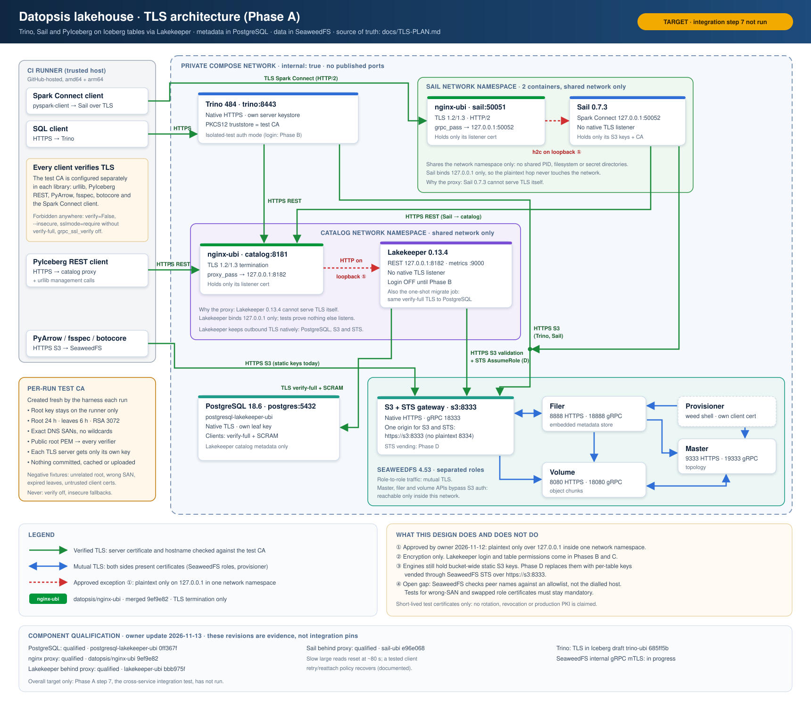
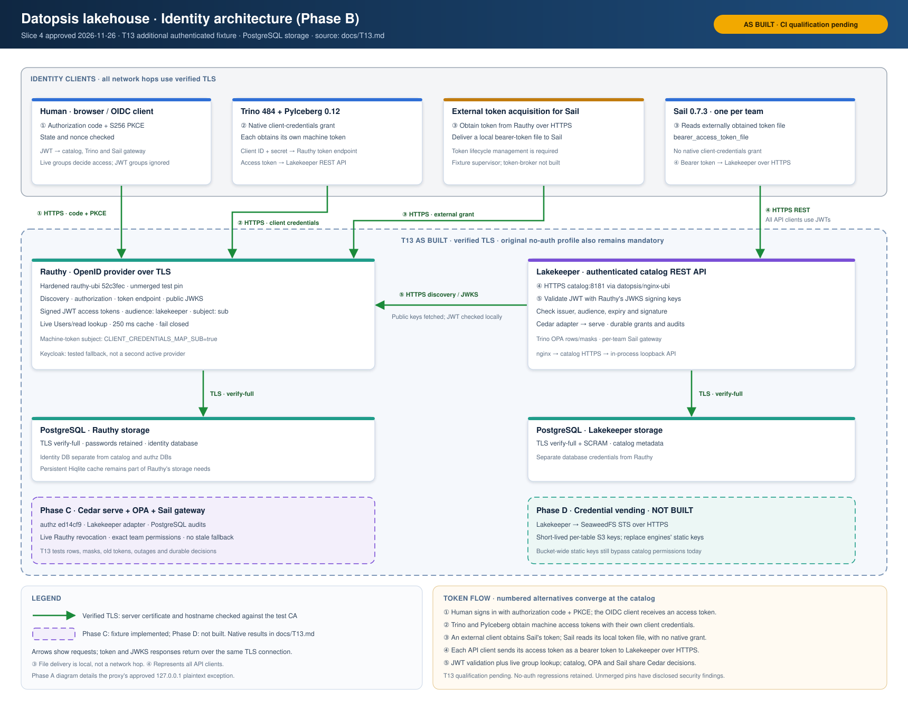
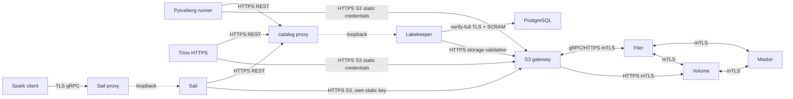
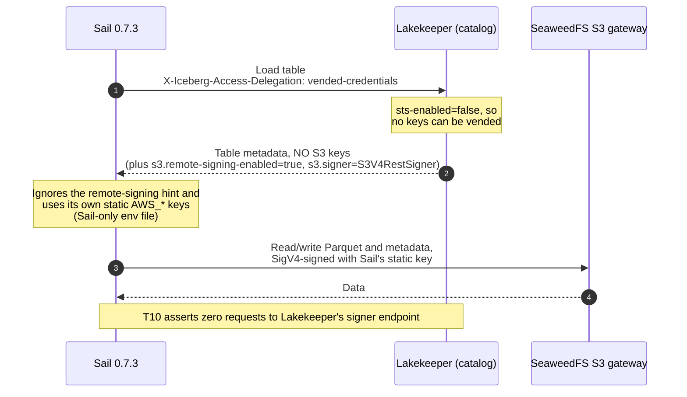

# Architecture

> **Phase A's runtime fixture is qualified on both native architectures:** see
> [run 43753536289 and its exact coverage](TLS-PLAN.md#step-7-evidence), the diagram below,
> [Phase A TLS as built](#phase-a-tls-as-built) and [TLS-PLAN.md](TLS-PLAN.md).

The Phase A diagram shows the as-built topology at the pins in
[images.lock.json](../images.lock.json), with the owner's 2026-11-12 loopback
exception. It supersedes the target design in the [TLS survey](TLS-PLAN.md).

The [Phase B identity target](diagrams/lakehouse-identity-architecture.svg) shows
Rauthy, chosen on 2026-11-13 with Keycloak as fallback, and its planned PostgreSQL
storage over verified TLS. Humans use authorization code with PKCE, Trino and
PyIceberg obtain machine tokens, and Sail 0.7.3 reads an externally obtained token
file; Lakekeeper validates those JWTs against Rauthy's JWKS. The groups claim is
reserved for Phase C authorization, while Phase D will vend per-table credentials
through SeaweedFS STS; neither is enabled in the main integration path. See the
[IdP bake-off evidence](IDP-BAKEOFF.md) and the separate
[Phase C acceptance evaluation](AUTHZ-EVALUATION.md).

The [Phase C evaluation view](diagrams/lakehouse-authorization-evaluation.svg)
records the separate, manual C1–C8 acceptance fixture. Its upstream OpenFGA image
and dedicated PostgreSQL stay evaluation-only; fixable Critical/High findings
preclude production adoption. The suite is the acceptance contract for every
future authorization backend ([2026-11-15 decision](DECISIONS.md)).

The Mermaid chart below shows the current test topology.

All eight long-running services share one internal network, with zero published
ports; the two nginx-ubi proxies share only the network namespace of their
application. The trusted Linux runner reaches bridge addresses and resolves the
service names through a temporary marked /etc/hosts block. A short-lived migration
container uses the same hardening and network. Negative-test containers also use
that profile and are explicitly removed. All images are built from images.lock.json
using their owning repository scripts; Podman-built images are exported into the
runtime store and inspected there.

| Role | UID:GID | Internal listeners | Persistent/writable paths | Secret delivery |
| --- | --- | --- | --- | --- |
| PostgreSQL | 26:0 | 5432 TLS 1.2/1.3 (hostssl SCRAM only) | pg-data at /var/lib/pgsql; /tmp tmpfs | PostgreSQL-only directory: admin and Lakekeeper passwords; own server key |
| Lakekeeper / migrate | 999:0 | 127.0.0.1:8182 API, 127.0.0.1:9000 metrics (serve) | none | Lakekeeper-only env file: verify-full database URL/password and encryption key; public CA |
| Catalog proxy (nginx-ubi) | 10001:0 | 8181 TLS, catalog namespace | /tmp tmpfs | own server key only; pinned upstream profile |
| Seaweed master | 1000:0 | 9333 HTTPS, 19333 gRPC (both mTLS) | master-data at /data | own security.toml, server/client keys, CA |
| Seaweed volume | 1000:0 | 8080 HTTPS, 18080 gRPC (both mTLS) | volume-data at /data | own security.toml, server/client keys, CA |
| Seaweed filer | 1000:0 | 8888 HTTPS, 18888 gRPC (both mTLS) | filer-data at /data (embedded store) | own security.toml, server/client keys, CA |
| Seaweed S3 | 1000:0 | 8333 HTTPS, 18333 gRPC mTLS | none | S3-only directory with s3.json; own security.toml, keys, CA |
| Trino | 10001:0 | 8443 HTTPS only | /var/lib/trino tmpfs; executable /tmp/trino tmpfs for native libraries | Trino-only env file with static S3 keys; own keystore, PKCS12 truststore, internal shared secret |
| Sail | 10001:10001 | 127.0.0.1:50052 Spark Connect | /tmp and /var/lib/sail tmpfs (noexec) | Sail-only env file with its own static AWS keys; read-only listener JSON; public CA |
| Sail proxy (nginx-ubi) | 10001:0 | 50051 TLS HTTP/2, Sail namespace | /tmp tmpfs | own server key only; pinned upstream profile |

Sail is defined in `integration/compose.sail.yaml`, always composed with the base
file for startup, recreation, diagnostics and teardown. Its separate probe/client
modules keep Spark dependencies out of the PyIceberg environment. T10 uses fresh
Spark sessions and fresh PyIceberg processes at every mutation boundary. With
every network hop encrypted, T10 captures only the catalog's internal loopback
hop (proxy to Lakekeeper, inside the catalog's own network namespace) and keeps
requests whose `X-Forwarded-For` is Sail's address: this shows the hard-coded
vending header, Lakekeeper's response and zero signer calls. Sail has its own S3
identity, so the S3 gateway's log shows which key signed Sail's requests. Only
redacted text is uploaded. No traffic is decrypted and no TLS is disabled.

Ports are internal configuration, not published host listeners. All roots are
read-only; every service drops ALL capabilities and sets no-new-privileges.
Tmpfs has nosuid/nodev; data tmpfs is noexec. Trino native libraries require the
explicit executable temp exception. Seaweed's 64 MiB volume size and four-volume
limit bound the test fixture, not production capacity.

The S3 fixture identity has Read:warehouse, Write:warehouse, List:warehouse.
[The pinned SeaweedFS authorization implementation](https://github.com/seaweedfs/seaweedfs/blob/4ab66fb76da83700739f5839e62fcaf15fb7d02a/weed/s3api/auth_credentials.go)
supports bucket-scoped actions. Admin/Tagging are not granted. A trusted weed
shell precreates the bucket. PostgreSQL stores catalog rows and encrypted S3
credentials; SeaweedFS stores Iceberg metadata JSON, manifests, Parquet data and
positional deletes. Trino/PyIceberg table locations are assigned by Lakekeeper;
Sail proposes `s3://warehouse/from_sail`, which Lakekeeper registers in that same warehouse.

Trust boundaries: service file mounts limit accidental cross-service secret
exposure; they do not isolate an already-compromised network member from the
unauthenticated Lakekeeper or Seaweed control APIs. Host/runner access is fully
trusted. Lakekeeper login off is a known test-only gap until Phase B. Trino uses TRINO_UBI_ALLOW_INSECURE=true, vending is disabled, and PyIceberg
explicitly selects client-managed credentials. Sail 0.7.3 requests vending, receives
remote-signing properties without keys, and uses its own static AWS environment
credentials successfully. The [T10 capture](SAIL-EVIDENCE.md) observes no signer
requests; the gate rejects any such request. No remote signer is needed on the main path.
T9 separately exercises a no-key remote-signing client and records the known
concurrent signer-registration race; see [the draft report](known-issues/remote-signing.md).

### How each engine gets S3 access

Lakekeeper's storage profile has `sts-enabled: false`, so the catalog can never hand
out S3 keys. Every engine therefore signs S3 requests with its own static keys. Trino
and PyIceberg choose this explicitly. Sail 0.7.3 asks for vended credentials (it
cannot be configured not to) and falls back to its own keys when none come back:

| Client | What it asks the catalog for | What it actually signs S3 requests with |
| --- | --- | --- |
| Trino | Nothing (`vended-credentials-enabled=false`) | Its own static keys |
| PyIceberg | `client-managed` | Its own static keys |
| Sail 0.7.3 | `vended-credentials` (hard-coded) | Its own static keys, because none are vended |

**Caveat: static keys bypass catalog authorization.** Each engine's S3 identity can
read and write the whole `warehouse` bucket (Read/Write/List). The catalog decides
which tables an engine can *find*, not which objects it can *read*. Today that changes
nothing, because Lakekeeper login is off and every caller is allowed everything. Once
OpenID login and table permissions are added (see the roadmap), those permissions will
NOT protect the data while engines hold bucket-wide static keys: an engine can read
any table's files directly from S3. For catalog permissions to be enforced on data,
the catalog must grant the S3 access itself, per table and short-lived. Lakekeeper
offers two ways, and on SeaweedFS only one of them isolates tables:

- **Credential vending (the chosen path).** Lakekeeper calls SeaweedFS's STS
  `AssumeRole` with a session policy limited to the table's location and hands the
  engine short-lived keys. STS exists in SeaweedFS 4.53 but is being qualified in
  `seaweedfs-ubi` (owner approval 2026-11-11, subject to adversarial tests).
- **Remote signing (not a table-isolation control on SeaweedFS).** Lakekeeper's own
  [storage documentation](https://github.com/lakekeeper/lakekeeper/blob/main/docs/docs/storage.md)
  states that SeaweedFS does not check every part of a signed request, so a client can
  alter a signed request to reach another table's files, and recommends vended
  credentials for SeaweedFS. Trino 484 also does not support it, and PyIceberg has the
  concurrency bug that T9 records. `seaweedfs-ubi` documents how to use it and its limits.

This switch is part of the security phases (TLS, OpenID, authorization, then
catalog-controlled data access). Also, when Sail is upgraded to
a release with configurable delegation (upstream commit `0c8333a`), set
`access_delegation` explicitly so this behaviour is a decision, not a fallback.

T5 removes containers/network using compose down without --volumes, then creates
a new stack. The four volumes and generated keys survive. Every nonempty container
ID must change; a fresh Python process reads all tables and validates a new write.
The encoding canary retains its exact decoder expectation across restart. Final
cleanup destroys volumes and restores the marked hosts block. This is graceful
recreation, not crash, power-loss, replication, or host-loss durability evidence.

Sail 0.7.3 mutations use explicit copy-on-write on an unpartitioned table. T10
requires no delete files from these mutations and distinct committed snapshots,
without imposing Trino's snapshot sequence on Sail. Sail also reads Trino's
mutated files with the adopted delta-length encoding setting. The separate
default-encoding canary stays mandatory. T5 checks Sail's new container ID,
rereads all four tables and verifies a new Sail write with both other clients.
Spark Connect itself stays unauthenticated (Phase B) but now binds only loopback;
the TLS proxy is its only network listener.

T8 follows T5 on the same private fixture. It creates a dedicated Iceberg v2 /
Parquet table and journals three successful 16-row INSERTs on the runner. One
`docker kill --signal=KILL` invocation targets all ten container IDs (eight services
and both proxies); every target
must stop with exit code 137. `compose start` reuses the same containers and named
volumes. Both Trino and a fresh PyIceberg process must read all 48 exact rows and
exactly four append snapshots (one empty CREATE plus three INSERTs) with matching IDs and parents.

Next, separate tables exercise PostgreSQL, Lakekeeper (`catalog`), SeaweedFS
`volume`, and `filer` in that order. A continuous writer assigns every INSERT a
unique batch ID and 16 deterministic rows. After at least two acknowledgements,
the injector polls Trino query state independently of the writer until it
observes RUNNING, then kills and starts that component while the loop continues.
Lakekeeper is killed together with its proxy: they share one network namespace.
Polling query state avoids missing short queries between statement response
pages. This targets an active workload, not a guaranteed storage-instruction
boundary. Even if the server finishes before the signal arrives, every client
acknowledgement is binding. The test fails if it cannot observe a RUNNING INSERT.

The runner flushes the attempt/acknowledgement journal outside the killed
containers. A failed client statement is ambiguous: after it reaches a terminal
state (or is explicitly cancelled and confirmed terminal), its entire batch may
be present or absent. No query is left running when rows are checked. Unknown
submissions that cannot be settled fail closed. Exact batch comparison rejects
partial, duplicate, unexpected or changed rows; every acknowledged batch is
mandatory. The snapshot count must equal one creation snapshot plus the number of fully
visible batches; the original empty creation snapshot must survive unchanged. All operations must be append, and the parent chain and current snapshot must
match. Both clients must agree on rows and snapshot metadata.

A new INSERT started after component restart must succeed. Recovery time is
measured from the kill command through that write and fresh-process verification
of all tables, with a 180-second component bound. Only readiness and workload
operations retry; durability assertions run once. Earlier tables and settled
in-flight outcomes are rechecked after every later kill. The existing encoding
canary keeps its exact decoder contract; no crash table has an encoding exemption.
Artifacts include the JSONL journal, reader logs and per-scenario results.

This is **single-host container-kill** testing. A container SIGKILL is not a host
power loss: the host page cache can survive. There is no fsync or disk-cache
qualification, no host-loss or replication evidence, and no claim of exhaustive
crash timing coverage. Real power-loss and host-loss tests remain on the roadmap.

## Phase A TLS as built

Network connections use TLS with server verification against a per-run test
CA, subject to the SeaweedFS residual risk below (`integration/pki.py`):
RSA-3072/SHA-256, a 24-hour root, six-hour leaves with
explicit DNS SANs and no wildcards. The signing keys are deleted once all
positive and negative leaves are issued; nothing is committed or uploaded, and
cleanup removes the material even on failure. Each service mounts read-only only
its own private files plus the public CA (`integration/tls_setup.py`).

| Hop | How it is verified |
| --- | --- |
| Runner urllib, PyIceberg REST, botocore, PyArrow, fsspec (T9) | Run CA via explicit context/`ssl.cabundle`/`verify=`, and `SSL_CERT_FILE`, `REQUESTS_CA_BUNDLE`, `AWS_CA_BUNDLE` set before import |
| Runner PySpark → Sail proxy | `sc://sail:50051/;use_ssl=true`, `GRPC_DEFAULT_SSL_ROOTS_FILE_PATH`, sail-ubi's pinned retry/reattach policy |
| Trino ingress, discovery, self-worker | HTTPS 8443 only, explicit internal keystore and truststore, per-run shared secret (trino-ubi isolated-test profile; login waived only) |
| Trino → catalog and S3 | JVM PKCS12 truststore emitted by the pinned image's guarded `truststore.properties` |
| Sail → catalog and S3 | `SSL_CERT_FILE`, HTTPS endpoints, `AWS_ALLOW_HTTP=false` (sail-ubi docs/TLS.md) |
| Lakekeeper (serve and migrate) → PostgreSQL | `sslmode=verify-full&sslrootcert=` in the URL |
| Lakekeeper → S3 | `SSL_CERT_FILE`, `https://s3:8333` storage profile |
| SeaweedFS roles | HTTPS and gRPC mutual TLS from the pinned seaweedfs-ubi PR #81 role profile; S3 port 8333 is native HTTPS with no plaintext listener |

An interim SeaweedFS trust setting is an owner-accepted residual risk for
a known SeaweedFS limitation, reported upstream; see seaweedfs-ubi PR #81.
Exact-outcome canaries fail the gate
if that behavior changes, so the setting is reviewed rather than silently kept.
External S3 clients do not present client certificates (not uniformly supported
by the engines); S3 authorization remains SigV4 with static keys until Phase D.

The exposure checks (`integration/tls_checks.py`) run after T7 and again after
T5 recreation and T8 crash recovery:

- an exact TCP/UDP listener inventory of every network namespace (only Docker's
  embedded resolver is excluded); loopback backends must bind only 127.0.0.1;
- plaintext refused on every exposed listener (HTTP, S3 root POST, HTTP/2 preface,
  PostgreSQL startup without TLS); old/backend ports refuse the runner and a
  separate container;
- verified handshakes on every listener, and mTLS required on all seven SeaweedFS
  HTTPS/gRPC listeners (absent, untrusted and expired client leaves; disallowed
  roles on gRPC).

The certificate-negative matrix runs once before T5. Real clients connect to a
verified TLS-to-TLS mutation relay (nginx-ubi) serving wrong-CA,
correct-CN/wrong-SAN and expired leaves, with valid controls before and after each
mutation: urllib, PyIceberg, PyArrow, botocore, PySpark, a second Trino, a second
Sail, a second Lakekeeper (S3 client), SeaweedFS's own Go client, and Lakekeeper's
SQLx client against a PostgreSQL impostor. A refusal needs zero relayed requests
plus a certificate alert, or a recorded hang-up with the exact verifier diagnosis.
The Lakekeeper S3 probe uses a separate disposable catalog database with the same
bucket-scoped credentials to avoid warehouse overlap; its management requests
stay on loopback inside its own network namespace.

## Native architecture gate

The owner superseded the initial amd64-only scope on 2026-11-11. One workflow
matrix runs the complete fixture in parallel on native GitHub-hosted Linux
`ubuntu-24.04` (amd64) and `ubuntu-24.04-arm` (arm64). `uname -m` must be `x86_64`
and `aarch64`, respectively. The build driver independently validates the native
Linux host and rejects a different requested architecture. No QEMU or emulation
is installed or used. Runtime tests and their assertions are identical.

Both jobs read the same `images.lock.json` and fetch the same full source SHAs.
Repository-owned build commands receive the native architecture; PostgreSQL's
build script detects it itself. Its provenance hash uses
`artifacts/locks/amd64.json` or `artifacts/locks/arm64.json`. Lakekeeper, SeaweedFS,
and Trino hash their shared `artifacts/<service>.lock.json` files and select the
native architecture's artifacts. Sail's shared Sail/RPM lock pair is hashed in
owner-defined order and its build receives the same verified native architecture.
Extracted Lakekeeper/SeaweedFS binary hashes
must also match that architecture's lock entry. The pinned cosign helper is
selected and checked for the native architecture before extracting its binary.
Every loaded image must have matching OCI architecture metadata, source revision,
and artifact-lock SHA-256. Missing or mismatched evidence fails without exceptions.

`Integration (amd64)` and `Integration (arm64)` retain separate sanitized artifacts.
Fail-fast is disabled so a failing architecture does not cancel the other. The
final required job is named exactly `Integration`: its matrix dependency waits
for both jobs, and its always-run success assertion rejects failure, cancellation
and skipping. The scheduled issue job depends on this aggregate and the unchanged
read-only upstream report, so either architecture's failure opens/updates the
existing weekly issue. Each job's Actions timestamps provide wall time and runner
minutes; sum runner durations for consumption, not overlapping elapsed wall time.

## T11 table maintenance

`integration/maintenance.py` writes twelve deterministic rows in six separate
INSERTs to an unpartitioned Iceberg v2/Parquet table through Trino 484 and
Lakekeeper. At least six current data files and seven snapshots (CREATE plus
INSERTs) must exist. `ALTER TABLE ... EXECUTE optimize` must reduce the data-file
count, replace the old files, and preserve every row in Trino, a newly loaded
PyIceberg table and a fresh Sail session.

Only the generated `maintenance` catalog lowers
`iceberg.expire-snapshots.min-retention=0s` and
`iceberg.remove-orphan-files.min-retention=0s`. These overrides are test-only,
for a disposable table with no concurrent writers. The main `iceberg` catalog
and default-encoding `canary` retain Trino's seven-day defaults. Both procedures
must reject zero retention through the main catalog with the exact
`INVALID_PROCEDURE_ARGUMENT` message; snapshots and S3 objects must be unchanged.
The property names and error contracts come from
[Trino 484 IcebergMetadata](https://github.com/trinodb/trino/blob/484/plugin/trino-iceberg/src/main/java/io/trino/plugin/iceberg/IcebergMetadata.java).

After compaction, an acknowledged thirteenth row advances the current snapshot.
Iceberg incremental cleanup retains files marked deleted by a still-retained
snapshot; advancing makes the rewrite snapshot and its deletion entries eligible
for expiry. This was observed in the first native CI run on both architectures.
Expiry must leave exactly the post-compaction append snapshot in `$snapshots`, keep
all thirteen rows in all three readers, and reject every expired snapshot ID with
`INVALID_ARGUMENTS` and its exact missing-snapshot message. Paginated S3 prefix
listings must prove that all data files referenced only by expired snapshots
are physically gone, and that current data files remain. No eventual-consistency
retry can hide a failed deletion assertion.

Orphan removal plants a distinct unreferenced object under the table's `data/`
prefix. Before and after listings are compared against live manifest entries
from every retained snapshot, manifest lists, manifests and current metadata.
The planted object must disappear, every reference must remain, reference sets
and the current snapshot must be unchanged, and all three clients must still
read exact rows. `results.json` retains the snapshot IDs and object inventories.
T5 rereads this table with all three clients; T8 includes it in the existing
exact row/snapshot crash manifest and additionally checks all three clients and
S3 references after the all-service kill and every component kill. Maintenance
itself is not interrupted mid-operation; that crash timing remains unqualified.
## T12 schema evolution and time travel

`integration/evolution.py` creates an Iceberg v2/Parquet table through Trino 484
and Lakekeeper with integer `id`, string `label`/`obsolete`, and `details` containing
integer `code`. It adds `note`, renames `label` to `title`, drops `obsolete`, widens
`id` to bigint, and adds nested `details.extra`. Each DDL is followed by exact
schema and row checks before any new write, then an INSERT and another exact
check. Old rows must have null new fields and retain their renamed values. The
wide INSERT uses 2147483648, beyond signed integer range. The nested INSERT carries
a non-null new field. PyIceberg also asserts field IDs and optionality: rename
and widening preserve identity; additions get new IDs. Schema-only commits must
not create data snapshots.

Six acknowledged data snapshots capture the original schema and each evolution
step. After all changes, Trino `FOR VERSION AS OF` and `FOR TIMESTAMP AS OF` must
return each snapshot's exact historical schema and rows, including the dropped
column and old names/types. UTC timestamp literals use snapshot commit milliseconds,
which must be strictly increasing. Fresh PyIceberg processes use
`scan(snapshot_id=...)` and assert the historical projection, field IDs and rows.
This checks the pinned clients' historical-schema behavior, not a latest-schema
projection of historical data. No table maintenance expires these snapshots.

Sail runs fresh Spark sessions and attempts every current-schema read and both
`VERSION AS OF` and `TIMESTAMP AS OF` reads. Its result schema includes names,
types, nesting and nullability. Any failure must match a measured per-query
exception class and complete message; an unknown error fails. Exact successful
schema/rows for a known failure emit a CI notice and summary. Wrong schemas or
rows always fail. No Sail query is silently skipped. Per-stage reader logs and
`results.json` retain evidence, including unexpected failures. T1–T10, T5/T8 and
the existing encoding/remote-signing canaries keep their assertions unchanged.

## T13 authenticated fixture (slice 4b)

Owner timing decision (2026-11-27): T13 runs only in the separate nightly/manual
`t13.yml` workflow, never on pull_request. The original TLS/crash/canary profile
and C1–C8 remain required in Integration. Both workflows use both native CPUs.
Its as-built configuration is in `integration/auth_probe.py`, `auth_fixture.py`,
`auth_trino.py` and `auth_sail.py`. The JWT-capable Trino pin is under whole-stack native qualification;
[the evidence ledger](T13.md) records actual results and limits. The unchanged
required `Integration` aggregate requires both native regression/C-suite jobs;
the separate `T13` aggregate requires both nightly/manual whole-stack jobs.

Rauthy stores identities in PostgreSQL and uses its TLS Hiqlite cache. Humans
log in with authorization code/S256 PKCE. Trino authenticates their signed JWTs
against Rauthy JWKS with exact issuer/audience and maps verified subjects to
`oidc~sub`; client identity headers cannot select another user's grants.
The REST connector and PyIceberg obtain client-credentials tokens. Each team Sail
receives only its own protected machine-token file. A trusted fixture supervisor
obtains those tokens; automatic token-broker lifecycle remains unimplemented.

The authz image runs `serve`, `sail-gateway` and private `sail-socket` roles.
The lakekeeper-authz image contains the compiled adapter. nginx retains the pinned
catalog profile with a generated, CA/hostname-verified HTTPS upstream to the
catalog image's loopback TLS listener. The stock OPA plugin calls the private
serve API with a separate decision-only key, no decision cache, row predicates
and NULL masks. Human membership comes from live Rauthy Users/read lookup with
a bounded 250 ms cache, never token groups. Each team Sail binds loopback in its
own namespace, reached through a private Unix socket by the gateway.

PostgreSQL, SeaweedFS and nginx reuse exactly the existing TLS-harness source pins.
The relationship store has a separate PostgreSQL container/database/login using
the same reviewed PostgreSQL image; no OpenFGA or additional database-image pin
is introduced. PostgreSQL clients require verify-full. Service roots are read-only,
capabilities dropped and no ports published. Current upstream acceptance helpers
are imported from the immutable authz pin without editing that checkout.

Revocation checks require fresh catalog requests, Trino queries and Spark sessions
within five seconds, including old unexpired tokens. Already admitted queries,
engine caches, fetched data and issued storage credentials are outside that bound.
All policy decisions require durable PostgreSQL audit commits; invalid transport
requests and a failed audit database cannot record their own failure. Gateway
admissions are reconciled exactly with durable records, and audit rows/digests
must survive PostgreSQL restart; UPDATE/DELETE/TRUNCATE must fail.

Static S3 keys remain private fixture scaffolding. Named-table denial does not
prove arbitrary-path storage isolation; Phase D STS remains unbuilt. Sail/direct
client machines receive no catalog grant on the row/mask fixture. Trino's trusted
connector can load it; deployment isolation of that credential remains required.
No production security qualification is inferred from this profile.

The two expensive native source-image builds (Rauthy and both authz outputs) may
be restored from immutable CI archives. Keys bind source pin, architecture and
build recipe. Fresh source/lock verification, archive checksum and exact image
inventory checks, independent image inspection and the strict provenance gate
remain mandatory on hits. Fixtures, secrets, policies/decisions and runtime tests
are never cached. Cold misses still build through the owner scripts. A separate
schedule-only job reconciles the single T13 issue, without checkout or artifact
reads, comments on result changes only and closes it on recovery.
