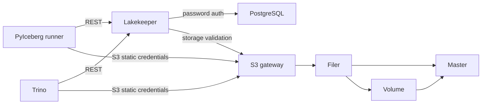

# Architecture

All seven long-running containers share one internal network, with zero published
ports. The trusted Linux runner reaches bridge addresses and resolves catalog,
s3, and trino through a temporary marked /etc/hosts block. A short-lived migration
container uses the same hardening and network. Negative-test containers also use
that profile and are explicitly removed. All images are built from images.lock.json
using their owning repository scripts; Podman-built images are exported into the
runtime store and inspected there.

| Role | UID:GID | Internal listeners | Persistent/writable paths | Secret delivery |
| --- | --- | --- | --- | --- |
| PostgreSQL | 26:0 | 5432 | pg-data at /var/lib/pgsql; /tmp tmpfs | PostgreSQL-only directory: admin and Lakekeeper passwords |
| Lakekeeper / migrate | 999:0 | 8181 (serve) | none | Lakekeeper-only env file: database URL/password and encryption key |
| Seaweed master | 1000:0 | 9333, 19333 gRPC | master-data at /data | none |
| Seaweed volume | 1000:0 | 8080, 18080 gRPC | volume-data at /data | none |
| Seaweed filer | 1000:0 | 8888, 18888 gRPC | filer-data at /data (embedded store) | none |
| Seaweed S3 | 1000:0 | 8333, 18333 gRPC | none | S3-only directory with s3.json |
| Trino | 10001:0 | 8080 | /var/lib/trino tmpfs; executable /tmp/trino tmpfs for native libraries | Trino-only env file with static S3 keys |

Ports are internal configuration, not published host listeners. All roots are
read-only; every service drops ALL capabilities and sets no-new-privileges.
Tmpfs has nosuid/nodev; data tmpfs is noexec. Trino native libraries require the
explicit executable temp exception. Seaweed's 64 MiB volume size and four-volume
limit bound the test fixture, not production capacity.

The S3 fixture identity has Read:warehouse, Write:warehouse, List:warehouse.
[The pinned SeaweedFS authorization implementation](https://github.com/seaweedfs/seaweedfs/blob/4ab66fb76da83700739f5839e62fcaf15fb7d02a/weed/s3api/auth_credentials.go)
supports bucket-scoped actions. Admin/Tagging are not granted. A trusted weed
shell precreates the bucket. PostgreSQL stores catalog rows and encrypted S3
credentials; SeaweedFS stores Iceberg metadata JSON, manifests, Parquet data and
positional deletes. Table locations are assigned by Lakekeeper.

Trust boundaries: service file mounts limit accidental cross-service secret
exposure; they do not isolate an already-compromised network member from the
unauthenticated Lakekeeper or Seaweed control APIs. Host/runner access is fully
trusted. Lakekeeper login off and plaintext internal traffic are known test-only
gaps. Trino uses TRINO_UBI_ALLOW_INSECURE=true, vending is disabled, and PyIceberg
explicitly selects client-managed credentials. No remote signer is needed.

T5 removes containers/network using compose down without --volumes, then creates
a new stack. The four volumes and generated keys survive. Every nonempty container
ID must change; a fresh Python process reads all tables and validates a new write.
The encoding canary retains its exact decoder expectation across restart. Final
cleanup destroys volumes and restores the marked hosts block. This is graceful
recreation, not crash, power-loss, replication, or host-loss durability evidence.
