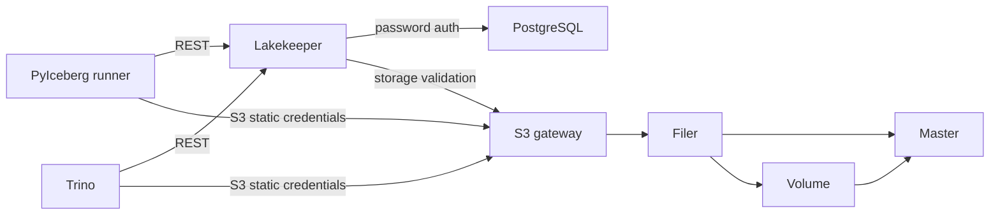

# Architecture

All seven long-running containers share one internal network, with zero published
ports. The trusted Linux runner reaches bridge addresses and resolves catalog,
s3, and trino through a temporary marked /etc/hosts block. A short-lived migration
container uses the same hardening and network. Negative-test containers also use
that profile and are explicitly removed. All images are built from images.lock.json
using their owning repository scripts; Podman-built images are exported into the
runtime store and inspected there.

| Role | UID:GID | Internal listeners | Persistent/writable paths | Secret delivery |
| --- | --- | --- | --- | --- |
| PostgreSQL | 26:0 | 5432 | pg-data at /var/lib/pgsql; /tmp tmpfs | PostgreSQL-only directory: admin and Lakekeeper passwords |
| Lakekeeper / migrate | 999:0 | 8181 API, 9000 metrics (serve) | none | Lakekeeper-only env file: database URL/password and encryption key |
| Seaweed master | 1000:0 | 9333, 19333 gRPC | master-data at /data | none |
| Seaweed volume | 1000:0 | 8080, 18080 gRPC | volume-data at /data | none |
| Seaweed filer | 1000:0 | 8888, 18888 gRPC | filer-data at /data (embedded store) | none |
| Seaweed S3 | 1000:0 | 8333, 18333 gRPC | none | S3-only directory with s3.json |
| Trino | 10001:0 | 8080 | /var/lib/trino tmpfs; executable /tmp/trino tmpfs for native libraries | Trino-only env file with static S3 keys |

Ports are internal configuration, not published host listeners. All roots are
read-only; every service drops ALL capabilities and sets no-new-privileges.
Tmpfs has nosuid/nodev; data tmpfs is noexec. Trino native libraries require the
explicit executable temp exception. Seaweed's 64 MiB volume size and four-volume
limit bound the test fixture, not production capacity.

The S3 fixture identity has Read:warehouse, Write:warehouse, List:warehouse.
[The pinned SeaweedFS authorization implementation](https://github.com/seaweedfs/seaweedfs/blob/4ab66fb76da83700739f5839e62fcaf15fb7d02a/weed/s3api/auth_credentials.go)
supports bucket-scoped actions. Admin/Tagging are not granted. A trusted weed
shell precreates the bucket. PostgreSQL stores catalog rows and encrypted S3
credentials; SeaweedFS stores Iceberg metadata JSON, manifests, Parquet data and
positional deletes. Table locations are assigned by Lakekeeper.

Trust boundaries: service file mounts limit accidental cross-service secret
exposure; they do not isolate an already-compromised network member from the
unauthenticated Lakekeeper or Seaweed control APIs. Host/runner access is fully
trusted. Lakekeeper login off and plaintext internal traffic are known test-only
gaps. Trino uses TRINO_UBI_ALLOW_INSECURE=true, vending is disabled, and PyIceberg
explicitly selects client-managed credentials. No remote signer is needed on the main path. T9 separately exercises a no-key
remote-signing client and records the known concurrent signer-registration race;
see [the draft report](known-issues/remote-signing.md).

T5 removes containers/network using compose down without --volumes, then creates
a new stack. The four volumes and generated keys survive. Every nonempty container
ID must change; a fresh Python process reads all tables and validates a new write.
The encoding canary retains its exact decoder expectation across restart. Final
cleanup destroys volumes and restores the marked hosts block. This is graceful
recreation, not crash, power-loss, replication, or host-loss durability evidence.

T8 follows T5 on the same private fixture. It creates a dedicated Iceberg v2 /
Parquet table and journals three successful 16-row INSERTs on the runner. One
`docker kill --signal=KILL` invocation targets all seven service IDs; every target
must stop with exit code 137. `compose start` reuses the same containers and named
volumes. Both Trino and a fresh PyIceberg process must read all 48 exact rows and
exactly four append snapshots (one empty CREATE plus three INSERTs) with matching IDs and parents.

Next, separate tables exercise PostgreSQL, Lakekeeper (`catalog`), SeaweedFS
`volume`, and `filer` in that order. A continuous writer assigns every INSERT a
unique batch ID and 16 deterministic rows. After at least two acknowledgements,
the injector polls Trino query state independently of the writer until it
observes RUNNING, then kills and starts that component while the loop continues.
Polling query state avoids missing short queries between statement response
pages. This targets an active workload, not a guaranteed storage-instruction
boundary. Even if the server finishes before the signal arrives, every client
acknowledgement is binding. The test fails if it cannot observe a RUNNING INSERT.

The runner flushes the attempt/acknowledgement journal outside the killed
containers. A failed client statement is ambiguous: after it reaches a terminal
state (or is explicitly cancelled and confirmed terminal), its entire batch may
be present or absent. No query is left running when rows are checked. Unknown
submissions that cannot be settled fail closed. Exact batch comparison rejects
partial, duplicate, unexpected or changed rows; every acknowledged batch is
mandatory. The snapshot count must equal one creation snapshot plus the number of fully
visible batches; the original empty creation snapshot must survive unchanged. All operations must be append, and the parent chain and current snapshot must
match. Both clients must agree on rows and snapshot metadata.

A new INSERT started after component restart must succeed. Recovery time is
measured from the kill command through that write and fresh-process verification
of all tables, with a 180-second component bound. Only readiness and workload
operations retry; durability assertions run once. Earlier tables and settled
in-flight outcomes are rechecked after every later kill. The existing encoding
canary keeps its exact decoder contract; no crash table has an encoding exemption.
Artifacts include the JSONL journal, reader logs and per-scenario results.

This is **single-host container-kill** testing. A container SIGKILL is not a host
power loss: the host page cache can survive. There is no fsync or disk-cache
qualification, no host-loss or replication evidence, and no claim of exhaustive
crash timing coverage. Real power-loss and host-loss tests remain on the roadmap.

## Native architecture gate

The owner superseded the initial amd64-only scope on 2026-11-11. One workflow
matrix runs the complete fixture in parallel on native GitHub-hosted Linux
`ubuntu-24.04` (amd64) and `ubuntu-24.04-arm` (arm64). `uname -m` must be `x86_64`
and `aarch64`, respectively. The build driver independently validates the native
Linux host and rejects a different requested architecture. No QEMU or emulation
is installed or used. Runtime tests and their assertions are identical.

Both jobs read the same `images.lock.json` and fetch the same full source SHAs.
Repository-owned build commands receive the native architecture; PostgreSQL's
build script detects it itself. Its provenance hash uses
`artifacts/locks/amd64.json` or `artifacts/locks/arm64.json`. Lakekeeper, SeaweedFS,
and Trino hash their shared `artifacts/<service>.lock.json` files and select the
native architecture's artifacts. Extracted Lakekeeper/SeaweedFS binary hashes
must also match that architecture's lock entry. The pinned cosign helper is
selected and checked for the native architecture before extracting its binary.
Every loaded image must have matching OCI architecture metadata, source revision,
and artifact-lock SHA-256. Missing or mismatched evidence fails without exceptions.

`Integration (amd64)` and `Integration (arm64)` retain separate sanitized artifacts.
Fail-fast is disabled so a failing architecture does not cancel the other. The
final required job is named exactly `Integration`: its matrix dependency waits
for both jobs, and its always-run success assertion rejects failure, cancellation
and skipping. The scheduled issue job depends on this aggregate and the unchanged
read-only upstream report, so either architecture's failure opens/updates the
existing weekly issue. Each job's Actions timestamps provide wall time and runner
minutes; sum runner durations for consumption, not overlapping elapsed wall time.
