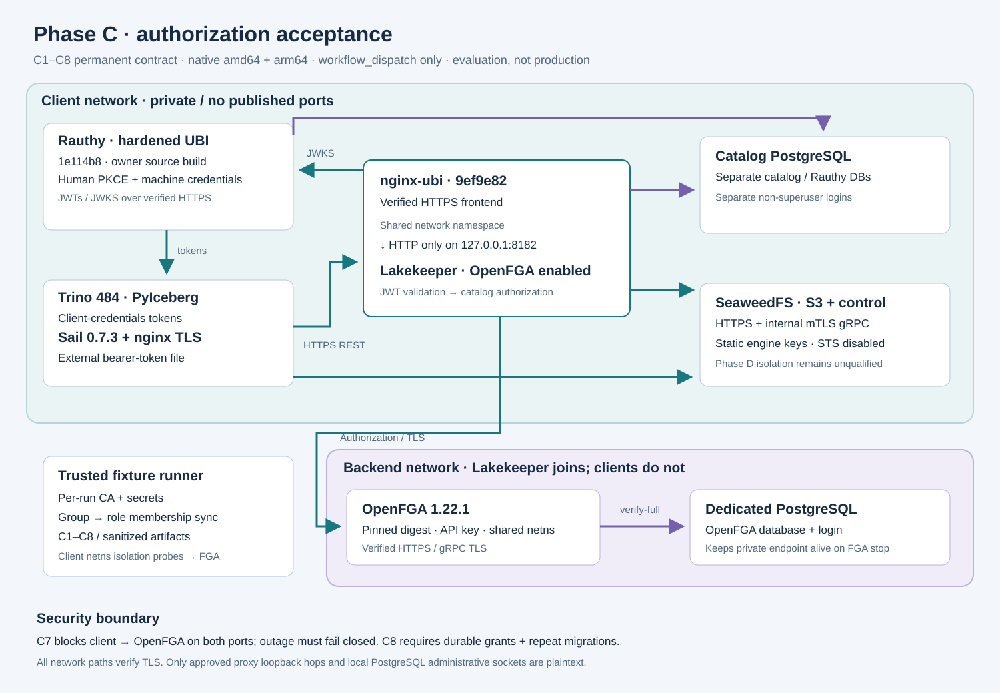

# Authorization acceptance suite (Phase C)

The owner selected **OpenFGA as the interim backend on 2026-11-13**. This is an
acceptance evaluation of that decision, not a new backend selection. Open-source
Lakekeeper supports OpenFGA and AllowAll; its Cedar integration is paid Lakekeeper
Plus. The planned own Cedar-based service is described in
[AUTHZ-PLATFORM-PLAN.md](AUTHZ-PLATFORM-PLAN.md). Every future backend must pass
**the same stable C1–C8 contract**, natively on amd64 and arm64.

## Acceptance contract

| ID | Exact required behavior |
| --- | --- |
| C1 | A namespace-A read grant lists and reads its exact table rows. Namespace B list/read and namespace/table creation, commit, drop and rename are denied. |
| C2 | Namespace grants cover existing and newly created tables. A single-table grant reads only that table; listing does not expose its sibling and loading the sibling is denied. |
| C3 | A genuine Rauthy access token containing `lake-readers` grants nothing by itself. A small sync reads authoritative Rauthy membership over verified TLS and maps it to a registered Lakekeeper role's OpenFGA assignee tuple. Addition allows exact reads; removal from Rauthy plus sync denies even the old, unexpired groups-bearing token. |
| C4 | Revoke an acknowledged grant, then poll fresh REST table loads for at most 30 seconds. Record every status and monotonic time from delete acknowledgement through first authorization denial. |
| C5 | Trino 484 and PyIceberg 0.12.0 obtain client-credentials tokens; Sail 0.7.3 reads an externally obtained token file. Each reads exact allowed rows and is denied other-namespace reads and writes. All three subtests must pass. |
| C6 | A denied load requesting vending returns 403/404 with no S3 keys/session token. Record the read-only response's configuration names. This profile has STS disabled; it must return no S3 keys. Document the source-level scope below. |
| C7 | Bob’s token cannot obtain Alice’s access using identity headers or a changed JWT subject. Genuine expired and wrong-audience tokens and a token signed with a different key return 401. OpenFGA HTTP/gRPC cannot be reached from client network namespaces. Stop OpenFGA: an otherwise allowed load returns an explicit structured error without metadata/credentials, then recovers to allow/deny correctly when OpenFGA returns. |
| C8 | OpenFGA restart preserves the complete tuple set and allow/deny decisions. Run both OpenFGA and Lakekeeper migrations twice; tuple sets and decisions remain intact. |

Authorization denials accept only catalog 403/hidden-object 404 or their typed
client equivalents. Authentication errors, TLS errors, arbitrary exceptions and
timeouts cannot satisfy an authorization denial. The intentionally stopped-backend
case separately requires a structured Lakekeeper error (403/500/503); a proxy
error or timeout does not pass. Prerequisite failures are **BLOCKED**, never PASS.
Every C test is mandatory; C5 retains per-client results when one client fails.

## Evaluation-only setup

The manual [workflow](../.github/workflows/authz-evaluation.yml) has only
`contents: read`, native `ubuntu-24.04` and `ubuntu-24.04-arm` runners, fail-fast
disabled and identical assertions. It is separate from the required `Integration`
check; `images.lock.json`, `integration/*` and their pins are unchanged.
Until GitHub registers the new workflow on main, the already registered
`idp-bakeoff.yml` offers an explicit `authorization` dispatch choice; its default
still runs the identity bake-off.

```bash
gh workflow run idp-bakeoff.yml --ref room/lakehouse-integration-authorization-back-jgzm -f suite=authorization
```

| Input | Evaluation pin / provenance |
| --- | --- |
| OpenFGA | Official 1.22.1 multi-platform digest `docker.io/openfga/openfga@sha256:b852071314f1fda1194d341a6ebac0a4f619b3cd87a6626d2ccc7048af4ec671`; native architecture asserted |
| Rauthy | `datopsis/rauthy-ubi` `1e114b84b01988bf15306b110b040378878488d3`; unchanged `scripts/build.sh`, architecture-specific artifact lock and strict revision/lock-hash labels |
| nginx | `datopsis/nginx-ubi` `9ef9e822c6b5e508cebef2adff3bb647a206773c`; owner build, strict provenance; unchanged Lakekeeper and Sail profiles |
| Catalog, storage, engines, PostgreSQL | Owner builds from unchanged `images.lock.json`, strict provenance for every image including Sail's paired locks |



A fresh per-run CA verifies Rauthy, catalog and engine HTTPS, S3 and SeaweedFS
control HTTP/mTLS gRPC, OpenFGA HTTP/gRPC and PostgreSQL (`verify-full`). Rauthy's
unmodified hardened launcher uses PostgreSQL, mounted secrets and verified TLS;
its Hiqlite cluster cache also uses TLS. Plaintext is confined to the approved
loopback proxy hops inside shared Lakekeeper/Sail network namespaces and local
PostgreSQL administration sockets. No ports are published.

OpenFGA has **its own PostgreSQL container**, database and login. Its private
backend network admits only OpenFGA, that database and Lakekeeper's shared proxy
namespace. Client containers have no backend-network attachment. C7 probes both
OpenFGA ports by IP from each client network namespace, avoiding a DNS-only test.
The PyIceberg runner is trusted host-side fixture code; its network isolation
probe uses a disposable container on the same client network.

Human PKCE login, token acquisition and CA trust reuse the IdP helpers. The
bootstrap operator has a separate machine subject; Lakekeeper trusts
`lakekeeper,operator,expiry`. A separate short-lived `expiry` token is genuinely issued
and accepted by `whoami`, then tested after expiry plus the verifier's 60-second
clock allowance, with a fresh-token control. No expired token is fabricated.
Only sanitized allowlisted reports are uploaded; secrets, private keys and SQL
dumps never become artifacts. Raw credential values are not recorded in C6.

## Native runtime evidence

Execution underway; no runtime pass is asserted yet. Results will link the actual
native jobs, with PASS / FAIL / BLOCKED kept distinct.

| Test | amd64 | arm64 |
| --- | --- | --- |
| C1 | Pending | Pending |
| C2 | Pending | Pending |
| C3 | Pending | Pending |
| C4 | Pending | Pending |
| C5 | Pending | Pending |
| C6 | Pending | Pending |
| C7 | Pending | Pending |
| C8 | Pending | Pending |

Revocation delay: not measured yet. First dispatched run:
[43744339236](https://github.com/datopsis/lakehouse-integration/actions/runs/43744339236).
Artifacts retain sanitized `builds.json`, `results.json`, the exact OpenFGA model,
service logs and information-only OpenFGA Trivy/Grype reports for 14 days.
Scanner execution failures remain failures, not zero findings.

## Phase D: source boundary and optional probe

The pinned [`load_table`](https://github.com/lakekeeper/lakekeeper/blob/9bd377162345b64a716f0a4fcffe4e7e7f3c7534/crates/lakekeeper/src/server/tables/load_table.rs)
authorizes the request before fetching storage secrets and calling
`generate_table_config`. The
[authorization result](https://github.com/lakekeeper/lakekeeper/blob/9bd377162345b64a716f0a4fcffe4e7e7f3c7534/crates/lakekeeper/src/server/tables.rs)
maps write permission to `ReadWriteDelete`, read permission to `Read`, and
metadata-only access to no storage permission. Thus **the authorization decision
gates credential vending and its requested scope**, not merely table visibility.

The [S3 implementation](https://github.com/lakekeeper/lakekeeper/blob/9bd377162345b64a716f0a4fcffe4e7e7f3c7534/crates/lakekeeper/src/service/storage/s3.rs)
constructs an inline STS policy using the table location and those storage
permissions, calls `AssumeRole`, and returns temporary keys/session token with
expiry. It caches temporary credentials. Revoking a catalog grant blocks later
catalog authorization; it does **not** invalidate credentials already issued or
data already fetched. Storage must enforce the inline policy and TTL.


C6 records the read-only response under the current `sts-enabled=false` profile:
no temporary S3 keys are expected. It does not qualify SeaweedFS STS or prove
storage isolation. Static engine keys remain an explicit Phase D gap; catalog
authorization cannot prevent a client using those keys to read S3 directly.
The retained `phase_d.py` is an optional diagnostic from the preparation draft;
it is not called by this acceptance suite and has no runtime qualification claim.

## What the pin actually supports

The main lock pins `lakekeeper-ubi` to
`2200c516919a9667e9761a6581b848de32b693d1`. Its
[artifact lock](https://github.com/datopsis/lakekeeper-ubi/blob/2200c516919a9667e9761a6581b848de32b693d1/artifacts/lakekeeper.lock.json)
identifies official Lakekeeper **0.13.4**, source commit
**`9bd377162345b64a716f0a4fcffe4e7e7f3c7534`**.

At that exact commit:

- The open-source binary's
  [authorizer factory](https://github.com/lakekeeper/lakekeeper/blob/9bd377162345b64a716f0a4fcffe4e7e7f3c7534/crates/lakekeeper-bin/src/authorizer.rs)
  implements **OpenFGA and AllowAll only**. `AuthZBackend::External(String)` is an
  extension mechanism, not evidence that any named policy engine is implemented.
  The factory chooses AllowAll when OpenFGA is not selected. Do not configure
  `cedar` on this binary and assume authorization is enforced.
- The pinned [authorization documentation](https://github.com/lakekeeper/lakekeeper/blob/9bd377162345b64a716f0a4fcffe4e7e7f3c7534/docs/docs/authorization.md)
  labels built-in Cedar as **Lakekeeper Plus**. That integration is separate from
  the open-source Cedar language and engine.
- The pinned [configuration documentation](https://github.com/lakekeeper/lakekeeper/blob/9bd377162345b64a716f0a4fcffe4e7e7f3c7534/docs/docs/configuration.md#authorization)
  explicitly says the default OpenFGA implementation **does not use token roles**.
  Setting `OPENID_ROLES_CLAIM=groups` parses the claim but does not grant access.
  The [OpenFGA authorizer](https://github.com/lakekeeper/lakekeeper/blob/9bd377162345b64a716f0a4fcffe4e7e7f3c7534/crates/authz-openfga/src/authorizer.rs)
  uses stored relationships; Rauthy emitting `groups` is insufficient.
- The pinned [OpenFGA guide](https://github.com/lakekeeper/lakekeeper/blob/9bd377162345b64a716f0a4fcffe4e7e7f3c7534/docs/docs/authorization-openfga.md)
  requires OpenFGA >=1.11 and describes namespace inheritance, explicit role
  membership, and a Trino OPA bridge. This evaluation exercises catalog checks,
  not Trino end-user impersonation or that bridge.

The [source inventory](authz-evidence/source.json) records exact file hashes,
upstream revisions, declared dependency counts, release dates, and public advisory
snapshots, surveyed 2026-11-13. These source conclusions are not runtime passes.

## Candidate comparison

| Question | OpenFGA 1.22.1 | Cedar 4.14.1 |
| --- | --- | --- |
| License / implementation | Apache-2.0 / Go | Apache-2.0 / Rust |
| Pinned Lakekeeper native backend | Yes | No; built-in Cedar is Plus |
| Rauthy `groups` directly grants access | Not consumed by this Lakekeeper authorizer | Can express groups in entities; an integration must authenticate and map claims |
| Namespace/table enforcement | Lakekeeper owns the model, hierarchy and permission checks | CLI prototype only; no catalog interception |
| Trino/PyIceberg machine identities | Both can acquire Rauthy tokens and face Lakekeeper checks | Needs a custom Trino access-control plugin or external enforcement point; PyIceberg/catalog paths need their own enforcement |
| Phase D credential scope | Lakekeeper read/write decision feeds credential generation | Standalone Cedar cannot gate Lakekeeper vending; needs a catalog integration |
| Durable state | OpenFGA database, separate from catalog DB | Library has no database; application owns policy/entity persistence |
| Integration cost | Deployment, DB, model lifecycle, role provisioning/synchronization | Principal/action/resource mapping, schema, entity resolver, policy deployment, failure behavior, cache/revocation and enforcement integration |
| Preferred use here | Phase C starting point, conditional on runtime results and group strategy | Future policy-engine option; not a replacement for this pin |

Cedar's [Apache-2.0 license](https://github.com/cedar-policy/cedar/blob/47d82a8293354f235d3f8d092c71071706401741/LICENSE)
and [library/CLI](https://github.com/cedar-policy/cedar/tree/47d82a8293354f235d3f8d092c71071706401741)
are open source. The official CLI exercises the same policy language without
inventing a Lakekeeper connector. A service/agent wrapping the library would also
need a versioned API, authenticated verified TLS (nginx-ubi where necessary),
policy/entity distribution, resource limits and fail-closed error handling.
A Trino-only plugin cannot protect clients that reach Lakekeeper directly. A
reverse proxy alone cannot infer all Iceberg actions, filter list responses or
safely scope credentials; it needs application-aware integration.


## Limits and future backends

This suite establishes a reusable catalog acceptance contract. It does not qualify
production HA, multi-replica cache bounds, load, backups/restored-service decisions,
policy upgrades, Trino end-user propagation, Spark Connect user authentication,
Cedar enforcement, STS isolation or already-issued storage credential revocation.
C3 is a one-group sync demonstration, not a production reconciler or polling SLA.
C4 measures one run per CPU and does not infer a distributed revocation guarantee.
Sail still requires an external token lifecycle component.

Future Cedar integration must preserve the C-suite IDs and assertions. Its group
adapter may consume verified claims directly; the equivalent controls must prove
unmapped groups cannot grant access and removed membership loses access. Backend
changes cannot replace runtime client tests with standalone policy-engine decisions.
