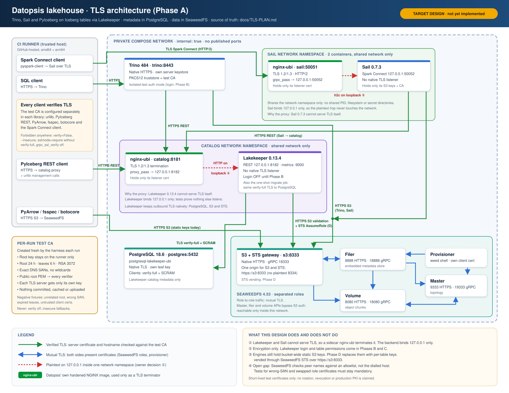
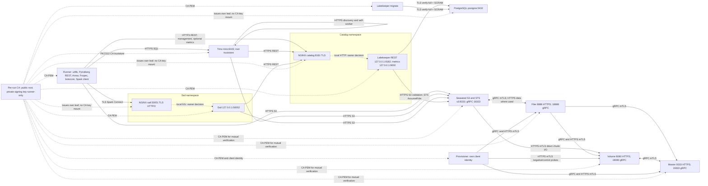

# Phase A: TLS design and service survey

The diagram summarises this plan; where they differ, this document is authoritative.

Survey date: 2026-11-11. **Design only: no TLS has been implemented or runtime
qualified by this PR.** The coordinator can dispatch the small image-repository
PRs below; admission still requires the unchanged native amd64/arm64
`Integration` gate. Settings, credentials policy, pins, and other repositories
are unchanged. The baseline is [images.lock.json](../images.lock.json),
[AGENTS.md](../AGENTS.md), [SECURITY.md](../SECURITY.md),
[ARCHITECTURE.md](ARCHITECTURE.md), and [ROADMAP.md](ROADMAP.md).

Recommended design: native verified TLS wherever supported, Seaweed control
HTTP and gRPC mTLS, and two separate NGINX instances for Lakekeeper and Sail.
Their plaintext backends must bind only to loopback in a shared network
namespace with their own proxy. A proxy forwarding plaintext across even a
private bridge does **not** meet this design.

**Owner decision required:** loopback proxy-to-process traffic is still
plaintext, as are local PostgreSQL Unix sockets. If “plaintext refused on every
listener” includes loopback, the pinned Lakekeeper and Sail cannot meet it:
native upstream TLS support is a blocker. This plan does not silently count
proxy termination as end-to-end TLS. No exception is authorized by this document.
Sources for the listener limitations: [Lakekeeper image][LK-image],
[Lakekeeper server][LK-serve], [Sail image][SA-image], [Sail server][SA-server].

## Evidence and versions

`Source-supported` means inspected docs/code at the version below, not a passing
binary test. `Image-qualified` means the owning repository documents tests; those
tests were read, not rerun here. `Unverified` is a required implementation gate,
not permission to skip verification. Mutable upstream web docs are supplemental;
versioned source wins when they disagree.

| Component | Integration image source pin | Upstream baseline / source of version |
| --- | --- | --- |
| postgresql-lakekeeper-ubi | `93666c251ca2c4e6618ddd35a669c4c3ea380313` | PostgreSQL **18.6**, architecture-specific [artifact lock][PG-lock]; its copied/inherited operator TLS profile is in [entrypoint][PG-entry] and [configuration][PG-image]. Sibling postgresql-ubi surveyed at `9b3190d4d3bccbd54d2f4965252762083f3ebeb7` ([profile][PG-parent]); not an additional integration image. |
| lakekeeper-ubi | `2200c516919a9667e9761a6581b848de32b693d1` | **0.13.4**, upstream `9bd377162345b64a716f0a4fcffe4e7e7f3c7534`; [lock][LK-lock]. |
| seaweedfs-ubi | `fd9b0001ee86a432faf773d40ab6f528dbfdad67` | **4.53 large_disk**, upstream `4ab66fb76da83700739f5839e62fcaf15fb7d02a`; [lock][SW-lock]. |
| trino-ubi | `964802b7afd3ae526039ef7dc7fcf605ce3d5b26` | **484**, [lock][TR-lock]; bundled Iceberg **1.12.0**, Airlift **451** ([POM][TR-pom]). Deliberate draft-release exception remains; no vulnerability qualification. |
| sail-ubi | `6e6f65a69108f4c6870eab26f356dccb41efbf35` | **0.7.3**, upstream `ac4690078021cf2a5402dc5c7b38a886f1916c73`; [lock][SA-lock]. Spark client **pyspark-client 4.2.0** in the image repo's separate [client lock][SA-client-lock]. |
| Runner | [requirements.txt](../requirements.txt) | **PyIceberg 0.12.0, PyArrow 25.0.1, botocore 1.43.117**; retain this hashed environment and Sail's separate environment. |
| Proxy candidates, not integration pins | nginx-ubi `aa60c0612e1043f77df7476ce97e30724719e784`; openresty-ubi `0cfe07cd4d97723d5f5f4e1765cc5b0db3a2a10a` | NGINX **1.30.6** ([image][NG-image]); OpenResty **1.31.8.1 / NGINX 1.31.8** ([image version][OR-version]). These are survey snapshots, not approved new dependencies. |

The starting listener inventory comes from [compose.yaml](../integration/compose.yaml),
[compose.sail.yaml](../integration/compose.sail.yaml), and
[ARCHITECTURE.md](ARCHITECTURE.md). Auxiliary listeners count: PostgreSQL 5432;
Lakekeeper REST/management 8181 and metrics 9000; Seaweed master 9333/19333,
volume 8080/18080, filer 8888/18888, S3 8333/18333; Trino 8080; Sail 50051.
Implementation must inspect actual listening sockets too, including IPv6,
health, metrics, profiling, and any newly enabled STS/IAM listener.

## Service matrix

Paths in this matrix are **proposed mount destinations**, not baked-in image
paths. All mounts are read-only. A service receives public CA material plus only
its own private keys. Client-certificate capability is distinct from the
server-certificate verification required on every network client.

| Service / direction | Native TLS? | Proposed settings and mounts | Verification / client certificates / gaps |
| --- | --- | --- | --- |
| PostgreSQL inbound | **Yes; image-qualified profile** | `POSTGRESQL_TLS_CERT_FILE=/run/tls/server.crt`, `POSTGRESQL_TLS_KEY_FILE=/run/tls/server.key`; certificate and key mounted only to postgres. | Entrypoint enforces TLS 1.2–1.3 and `hostssl` SCRAM; plaintext TCP fails. PostgreSQL supports client certificates upstream, but the image profile does not provide client-certificate mapping. Retain passwords; Phase A needs server authentication, not PostgreSQL mTLS. [Image][PG-image], [code][PG-entry], [PG 18 server docs][PG-upstream]. |
| Lakekeeper inbound REST, management, metrics | **No** in 0.13.4 | NGINX at `https://catalog:8181`; Lakekeeper `LAKEKEEPER__BIND_IP=127.0.0.1`, backend port 8182 (`LAKEKEEPER__LISTEN_PORT`), metrics 9000. Proxy public certificate/key only in catalog proxy. | Plain TCP server; metrics also use `CONFIG.bind_ip`. Proxy `/metrics` to loopback 9000 if needed; otherwise no network metrics exposure. TLS client authentication could be enforced by proxy but is not proposed for REST clients. Lakekeeper login remains off, separately documented. [Image][LK-image], [configuration][LK-config], [server][LK-serve], [metrics][LK-metrics]. |
| Lakekeeper → PostgreSQL (serve **and migrate**) | **Yes; verify-full supported in code** | URL ends `?sslmode=verify-full&sslrootcert=/run/tls/ca.crt`; mount CA to catalog and migrate. Apply to read URL if set. Alternatively separate PG fields plus `LAKEKEEPER__PG_SSL_MODE=verify-full` and `LAKEKEEPER__PG_SSL_ROOT_CERT`. | URL branch bypasses `PG_SSL_MODE`; do not set only that env var alongside the current URL. Upstream docs' mode list omits verify-full, but enum accepts it. SQLx **0.9.0** also parses `sslcert`/`sslkey`; client-cert presentation is source-supported, unqualified, and unnecessary with this server profile. [PG builder][LK-pg], [enum][LK-pg-config], [SQLx parser][SQLX], [dependency lock][LK-cargo]. |
| Lakekeeper → S3 and STS | **Yes; source-supported custom CA** | `SSL_CERT_FILE=/run/tls/ca.crt`; storage-profile `endpoint=https://s3:8333`, explicit `sts-endpoint=https://s3:8333` when STS enabled. | Shared Smithy HTTPS client loads native/custom roots plus bundled webpki roots; both S3 and AssumeRole configurations derive from that SDK config. No exposed S3/STS client-key configuration found: do not require external S3 mTLS. Prove custom CA separately for S3 and the actual AssumeRole call; do not assume `AWS_CA_BUNDLE` configures this Rust stack. [TLS docs][LK-config], [SDK construction][LK-io], [vending][LK-s3]. |
| Seaweed S3/STS inbound | **Yes; S3 HTTPS image-qualified** | `-cert.file=/run/tls/server.crt -key.file=/run/tls/server.key`; retain port 8333; **omit `-port.https`**. | `-port.https` leaves a plaintext listener beside TLS; image guard rejects it unless explicitly overridden. S3 optionally supports `-cacert.file` and `-tlsVerifyClientCert`; not selected because Lakekeeper/engine client identities are not uniformly exposed. STS routes share S3's HTTP handler, so use the same HTTPS origin. STS credential semantics are the parallel qualification's responsibility. [Image TLS evidence][SW-image], [listener][SW-s3], [routing][SW-routes]. |
| Seaweed master/volume/filer/S3 gRPC | **Yes, mutual TLS; identity caveat** | Per-role `/etc/seaweedfs/security.toml`: `[grpc] ca`, `[grpc.<role>] cert,key,client_cert,client_key`, and `[grpc.client] cert,key` for generic callers. Paths resolve only to that container's own server/client files. | Requires client certificates and verifies chains. **Default `advancedtls.CertVerification` does not do ordinary target-hostname validation.** Explicit server identity allowlists and client identity restrictions are needed; see below. S3 uses `grpc.client` outbound and `grpc.s3` inbound. [Image][SW-image], [TLS implementation][SW-grpc], [scaffold][SW-scaffold], [S3 code][SW-s3]. |
| Seaweed master/filer/volume HTTP and inter-role data transfer | **Yes in 4.53 code; image-unqualified** | `[https.master]`, `[https.filer]`, `[https.volume]`: `cert,key,ca`. Every participating caller: `[https.client] enabled=true`, `ca`, its own `cert,key`, `insecure_skip_verify=false`. | Server `ca` requests/verifies client certificates. Filer must keep `disable_tls_verify_client_cert=false`. HTTPS client verifies peer CA/hostname and switches data URLs to HTTPS. Must qualify redirects, advertised names, direct volume I/O, and restart on the actual binary. gRPC TLS alone leaves these paths plaintext. [Scaffold][SW-scaffold], [HTTP client][SW-http], [master][SW-master], [filer][SW-filer], [volume][SW-volume], [image gap][SW-image]. |
| Trino inbound and internal self-communication | **Yes** | Disable HTTP; enable HTTPS 8443; `http-server.https.keystore.path=/run/tls/server.pem` (PEM key + chain) or PKCS12. Explicit internal keystore/truststore, shared secret, HTTPS discovery. | Preserve the current login exception only if owner accepts it; TLS does not require disabling peer verification. Image's normal profile couples TLS to PASSWORD authentication, while its explicit isolated-test opt-out allows custom config. Avoid automatically generated internal certificates if requiring the harness CA for every connection. See exact properties below. [Image entrypoint][TR-entry], [484 TLS docs][TR-tls], [internal config][TR-internal-config], [automatic-TLS branch][TR-internal-module]. |
| Trino → catalog and S3 | **Yes; custom truststore must be qualified for both clients** | `iceberg.rest-catalog.uri=https://catalog:8181/catalog`, `s3.endpoint=https://s3:8333`; read-only PKCS12 truststore and JVM `javax.net.ssl.trustStore`, `trustStoreType`, `trustStorePassword`. | REST uses Iceberg HTTP client; native S3 uses AWS Apache5 client. Do not mistake Airlift HTTP-client trust settings for coverage of these two clients. Keep hostname verification. Java client keys are possible at library level, but no qualified connector-level client-cert profile is established here; use server-only TLS externally. [REST factory][TR-rest], [S3 loader][TR-s3], [Iceberg HTTP client][ICE-http]. |
| Sail Spark Connect inbound | **No** in 0.7.3 | Separate NGINX at `sail:50051`, TLS + HTTP/2; backend JSON `bind=127.0.0.1`, `port=50052`, `allow_unauthenticated_remote=false`. | Tonic TLS dependency does not enable server TLS: shared server builder serves a raw TCP incoming stream and exposes no certificate settings. Secure Spark client must use TLS credentials and test CA; do not infer server support from a `sc://` client TLS option. [Image entrypoint][SA-entry], [upstream server][SA-server], [config docs][SA-config]. |
| Sail → catalog and S3 | **HTTPS yes; custom CA source-supported, shipped-wheel unverified** | HTTPS catalog URI in `SAIL_CATALOG__LIST`; `AWS_ENDPOINT=https://s3:8333`, `AWS_ALLOW_HTTP=false`, path-style setting retained; `SSL_CERT_FILE=/run/tls/ca.crt`. | REST constructs reqwest `Client::new()`; S3 uses object_store `AmazonS3Builder::from_env()`. Reqwest **0.12.28** direct feature is webpki roots, but object_store **0.13.2** enables the same reqwest's native roots; Cargo feature unification supports the proposed CA path. The lock includes rustls-native-certs. **This is an inference about the build, not binary evidence.** No exposed REST/S3 client identity found. If wheel fails, require an upstream-supported CA path/reviewed release, never skip verification. [REST code][SA-rest], [S3 code][SA-s3], [workspace manifest][SA-cargo], [lock][SA-cargo-lock], [object_store manifest][OS-cargo], [reqwest docs][REQ-doc]. |
| PyIceberg runner → REST | Client only; **yes** | `RestCatalog(..., ssl={"ca-bundle": CA_PATH})`; HTTPS URI. Also `REQUESTS_CA_BUNDLE` for Requests-based signer paths. | REST accepts `ssl.client.cert`/`ssl.client.key` if later needed. Main phase keeps client-managed S3 credentials. Actual session validation required after server-provided config merges. [0.12.0 REST source][PY-rest], [docs][PY-config], [existing client](../integration/probe.py). |
| PyIceberg runner → S3 (both implementations) | Client only; **yes, separate CA paths** | Set `SSL_CERT_FILE` **before importing PyArrow**; Linux Arrow 25.0.1 initializes CA paths from Python SSL defaults. Set `AWS_CA_BUNDLE` for botocore/s3fs/aiobotocore; explicit `verify=CA_PATH` for harness botocore clients. | Keep main `PyArrowFileIO`; T9 uses FsspecFileIO. PyIceberg 0.12.0 does not forward a generic S3 CA property to Arrow, even though Arrow itself exposes `tls_ca_file_path`. Do not switch FileIO to avoid qualification. External S3 client-certificate setup is not uniformly exposed; not proposed. [PyArrow IO][PY-arrow], [Fsspec IO][PY-fsspec], [Arrow CA initialization][AR-ca], [botocore config][BOTO-ca]. |

### Seaweed identity and HTTP coverage

The image's sample shared security.toml is explanatory, not a license to mount
all role keys everywhere. Generate one file per role with the same public CA
and policy, but only local identity paths. Use separate `serverAuth` and
`clientAuth` certificates. Populate generic `[grpc.client]` on the S3 gateway
and provisioning client; populate component-specific client fields on master,
volume, and filer. The exact call sites matter. [TLS loader][SW-grpc],
[filer target selectors][SW-filer-server], [shell][SW-shell].

Configure inbound `grpc.<role>.allowed_commonNames` to the intended client
identities. For outgoing server identities use the smallest applicable
`allowed_server_commonNames`, with filer's `master_allowed_server_commonNames`,
`volume_allowed_server_commonNames`, and `s3_allowed_server_commonNames`.
Do not use wildcard domains or a global list of every service as a substitute
for checking the intended peer. Upstream matches CN, DNS SAN, or URI SAN in
this allowlist, rather than binding verification to the dial target; an allowed
CN with an incorrect DNS SAN can still pass. Therefore test both a completely
wrong identity and **correct CN / wrong DNS SAN**, plus swapping two valid role
certificates. [Implementation][SW-grpc], [tests][SW-grpc-tests].

**Source-level gap:** the correct-CN/wrong-SAN case is predicted to be accepted
by the inspected matcher. The configuration is not a general replacement for
DNS hostname verification; a binary test must establish the actual result.
**Blocking qualification question:** can every exercised outgoing gRPC edge be
restricted to its target at this pin? If the required DNS mismatch/swap negatives
pass unexpectedly, the owning repo must report a blocker and propose a reviewed
upstream hostname-verification fix/release. Adding broad allowlists or declaring
chain verification equivalent to hostname verification is not acceptable.
No such upstream change is authorized by this design PR.

Cover both gRPC metadata/control calls and HTTPS data calls: S3 ↔ filer; S3 →
volume (direct chunk reads); filer → volume; filer/volume → master; master →
volume; and filer → S3 callbacks. Probe all four gRPC listeners even when a
particular RPC is idle. Inventory any further observed edges rather than assuming
the original simplified architecture graph is exhaustive. Names advertised by
`-ip`/public URL settings must stay `master`, `volume`, `filer`, `s3`, not unstable
bridge IPs; any direct-IP TLS target needs a reviewed IP SAN. Avoid opening a
second volume public HTTP listener. [S3][SW-s3], [filer server][SW-filer-server],
[HTTP client][SW-http], [volume listener][SW-volume].

HTTPS and mTLS do not implement S3 authorization on filer/volume APIs. Preserve
their private-network boundary; a trusted control-plane client still has powerful
direct access. The pinned image explicitly documents this gap. [TLS.md][SW-image].

### Trino and Python trust details

Proposed Trino settings include `http-server.http.enabled=false`,
`http-server.https.enabled=true`, `http-server.https.port=8443`,
`internal-communication.https.required=true`,
`internal-communication.https.keystore.path`,
`internal-communication.https.truststore.path` and their `.key` passwords,
`internal-communication.shared-secret`, and `discovery.uri=https://trino:8443`.
Set `node.internal-address=trino` so the single coordinator/worker does not
advertise an uncertified bridge IP. Explicit stores avoid the automatic internal
certificate branch; verify both discovery and self-worker requests use the test
CA and correct identity. These are proposed configurations, still unverified.
[484 internal docs][TR-internal], [config][TR-internal-config],
[selection code][TR-internal-module].

The image directly execs Java, does not read a conventional `jvm.config`, and
**rejects `JAVA_TOOL_OPTIONS`, `JDK_JAVA_OPTIONS`, and `_JAVA_OPTIONS`**.
Its small image PR must add a narrowly guarded truststore setting which emits
only the required `-Djavax.net.ssl.trustStore`, `trustStoreType` and
`trustStorePassword` arguments. Keep the general Java-option override prohibition;
do not recommend an environment override that the pinned image refuses. JVM-wide truststore
support for both the bundled Iceberg and AWS clients must be proved with real
REST/S3 operations, including all certificate negatives. Do not invent an
`iceberg.rest-catalog.ssl.*` property or assume `http-server.https.truststore.path`
configures outbound clients. [Entrypoint][TR-entry], [REST][TR-rest], [S3][TR-s3].

For the runner, configure urllib with `ssl.create_default_context(cafile=...)`,
Requests/PyIceberg with the CA bundle, botocore with explicit verification, and
Arrow through pre-import `SSL_CERT_FILE`. Apply these to **every fresh process**,
including crash readers, recreation readers, Sail interoperability's PyIceberg
reader, and T9's signer. Prove the positive path first, then certificate failures
through each library. Do not rely on `REQUESTS_CA_BUNDLE` to configure Arrow or
`SSL_CERT_FILE` alone to configure botocore. [Harness](../integration/probe.py),
[crash readers](../integration/crash.py), [signer tracing](../integration/remote_signing.py),
[Arrow][AR-ca], [botocore][BOTO-ca], [REST][PY-rest].

## Proxy choice and boundary

Recommend **datopsis/nginx-ubi**, one container per unsupported service. Its
surveyed version has TLS termination, mTLS, and verified upstream TLS profiles;
the feature inventory includes HTTP SSL and HTTP/2. OpenResty is a viable
alternative, but its Lua capability is unnecessary here and its image docs place
custom TLS policy on the operator. Neither has been run with this fixture.
Sail gRPC streaming and compiled module availability require a real handshake
and Spark workload, not just `nginx -t`. [NGINX profiles][NG-profiles],
[feature inventory][NG-features], [OpenResty contract][OR-image],
[NGINX gRPC docs][NG-grpc].

Proposed namespace layout: `catalog` and `sail` remain the network-bearing app
containers; their proxies use Compose `network_mode: service:catalog` and
`service:sail`. Applications bind loopback on their backend ports; proxies bind
the private interface on 8181 and 50051. They share networking only, **not** PID
namespaces, filesystems, or secret directories. No ports are published. The
catalog app sees its DB password/encryption key/CA; its proxy sees only catalog
TLS material. The Sail app sees only its AWS credentials/CA/config; its proxy
sees only Sail listener TLS material. Runtime hardening applies independently.
This is a proposed Compose design requiring isolation and lifecycle tests.

NGINX config: `listen <port> ssl`, TLS 1.2/1.3, `ssl_certificate` and
`ssl_certificate_key` from `/run/tls`; HTTP/2 enabled on Spark Connect, with
`grpc_pass grpc://127.0.0.1:50052`. Lakekeeper uses
`proxy_pass http://127.0.0.1:8182`. Do not expose HTTP redirects or plaintext
health listeners. Metrics, if exposed, use the catalog TLS endpoint. If a future
backend can serve TLS, use `https://`/`grpcs://` with `proxy_ssl_verify on` or
`grpc_ssl_verify on`, explicit CA, server name and SNI. Default upstream
verification must never be assumed. [TLS directives][NG-ssl],
[gRPC directives][NG-grpc], [verified upstream example][NG-upstream].

Preserve request host, path, body and query; overwrite forwarded headers using
trusted proxy values. Set Lakekeeper's external `LAKEKEEPER__BASE_URI` to
`https://catalog:8181` and check returned catalog/signing URLs. Use bounded
timeouts compatible with the existing workload, streaming gRPC trailers and
large results; disable proxy retries of mutations. Avoid buffering/logging
credentials. Recreate proxy namespaces with their apps during T5; include both
proxies in all-service SIGKILL and readiness checks in T8. A network-namespace
design must not strand a proxy on an old app namespace after replacement.
[Lakekeeper config][LK-config], [NGINX profile][NG-profiles],
[existing restart contract](../integration/crash.py).

Sail client proposal: use `sc://sail:50051/;use_ssl=true`. The pinned
pyspark-client 4.2.0 `DefaultChannelBuilder` selects
`grpc.ssl_channel_credentials()` for that option. Supply the run CA before gRPC
initialization through its root-file environment, or use the supported
`ChannelBuilder` with `grpc.ssl_channel_credentials(root_certificates=...)`.
The exact custom-CA channel construction and streaming behavior are still
**runtime-unverified** and belong in sail-ubi's client rehearsal; the current
`sc://sail:50051` alone is plaintext. Do not set an SSL target-name
override to hide a SAN mismatch. If mTLS is later selected, use a dedicated
runner identity through a supported client channel builder, never Sail's server
key. [Current client](../integration/sail_client.py), [pinned client lock][SA-client-lock],
[Spark 4.2.0 channel implementation][SP-client].

## Per-run certificate design (proposed)

1. Harness creates a fresh self-signed test root under ignored
   `.runtime/pki-authority/` with umask 077; root `CA:TRUE`, signing key usage,
   random serials. Root valid 24 hours; leaves valid 6 hours, with five-minute
   not-before skew allowance. Use RSA 3072/SHA-256 for compatibility with the
   surveyed NGINX RSA profile. Fail preflight if expiry cannot cover the job;
   never extend validity or disable clock checks to make a test pass.
2. Root private key remains runner-only. Issue all positive and negative
   fixtures before starting services; remove signing key when no more issuance
   is needed. Nothing under `.runtime/` is committed, cached or uploaded.
   Reuse the run's **leaf** files and CA through T5/T8; a new invocation creates
   a new root. Cleanup removes PKI even on failure, after sanitized evidence.
3. Server SANs: postgres=`DNS:postgres`; catalog proxy=`DNS:catalog`;
   master=`DNS:master`; volume=`DNS:volume`; filer=`DNS:filer`;
   S3/STS=`DNS:s3`; Trino=`DNS:trino`; Sail proxy=`DNS:sail`.
   No wildcards, no CN-only server identities. Use DNS names consistently on
   the runner and network. Add an IP SAN only for an explicitly retained IP
   target; never disable hostname verification or add all bridge addresses.
4. Issue separate Seaweed client leaves (for example `master-client`,
   `volume-client`, `filer-client`, `s3-client`, `provisioner-client`) with
   `clientAuth`, matching CN/identity restrictions. Server leaves have
   `serverAuth`. Every role's HTTP/gRPC client key is unique; reuse within that
   role only where supported. CA possession alone does not confer an intended
   peer role: enforce identity restrictions as described above.
5. Publish the same public root PEM to each verifier. Trino also receives a
   PKCS12 truststore built from that root and its own server keystore. Private
   files go in separate `.runtime/tls/<service>/` directories; mount individual
   files or that service's directory, never `.runtime/tls` or the CA directory.
   Native TLS services get their own keys; proxy-backed apps get no server key.
6. Use root-owned `0440`, GID 0 private files for applicable group-0 images
   (including postgres UID 26, Lakekeeper 999, Seaweed 1000, Trino 10001,
   NGINX 999). Sail CA/config can be public `0444`; any future Sail-owned key
   uses UID/GID 10001 and `0400`. Directories must allow only the intended
   readers. Mount `:ro`; validate ownership/modes as well as inability to read
   another service's key, even where images share GID 0. Shared GID is not
   secret isolation; mount boundaries are. [Current identities](ARCHITECTURE.md),
   [PostgreSQL file rules][PG-image], [NGINX image][NG-image].
7. Generate an unrelated root, same-root wrong-SAN leaves, same-root expired
   leaves, and untrusted/expired client leaves. Backdate expired fixtures at
   issuance; do not change system time or wait for expiry. Keep the valid CA
   and all non-target properties constant to isolate each failure.

The fixture's positive verifier must trust the positive root, not the negative
root. Some binaries add system/webpki roots; a private unrelated negative root
still proves rejection. This is not a claim of exclusive trust-root pinning.
Missing/unreadable CA/key or malformed truststore must fail closed. Full online
rotation, revocation and production PKI operations are beyond Phase A; retain
the short-lived test model and record the limitation. [Lakekeeper roots][LK-config],
[NGINX lifecycle guidance][NG-lifecycle], [Seaweed lifecycle caveat][SW-image].

## Target connections and trust anchors

Solid arrows below are required verified TLS; bidirectional control links denote
RPCs in either direction, not a second shared certificate. Dotted arrows show
trust provisioning or the explicitly unresolved local plaintext exception.
Unused listeners must be closed, not exempted. This is the target design, not
the current architecture. See the service matrix for source evidence and gaps.

## S3/STS coordination contract

Reserve the single canonical HTTPS origin `https://s3:8333` for both S3 and
STS. The STS qualification can enable/configure the S3 gateway's STS handler
without introducing a plaintext 8334 or separate HTTP IAM service. Lakekeeper
calls **AssumeRole over HTTPS**, with `sts-endpoint` explicitly set and the same
verified CA path as S3. S3 SigV4 and issued session-token checks stay enabled.
If the parallel work concludes a separate STS listener is required, it must
have native TLS or an isolated proxy, its own hostname/SAN if different, and
the full negative matrix before admission. [Seaweed STS dispatch][SW-routes],
[Lakekeeper AssumeRole][LK-s3], [S3 HTTPS hazard][SW-image].

TLS changes do not authorize switching the main fixture to vending. The current
owner contract remains static S3 credentials, Trino vending off, PyIceberg
client-managed, and Sail 0.7.3's observed static path despite its hard-coded
vending request. Keep STS qualification separate until the owner accepts a
credential-mode change. Test real HTTPS AssumeRole in the owning repos and,
when admitted, an isolated integration case; distinguish TLS rejection from an
STS policy/protocol error. [AGENTS.md](../AGENTS.md),
[Sail evidence](SAIL-EVIDENCE.md), [current storage profile](../integration/probe.py).

## Ordered implementation dispatch

Each numbered image entry is **one small PR in that repo**, not permission for
this design agent to modify it. Reuse existing native features; avoid rebuilding
or patching upstream binaries as an incidental packaging change. Where an entry
hits a blocker, return evidence and an upstream/release decision before expanding
scope. Repositories with no necessary implementation change need only a focused
qualification/docs PR. All must retain their own security/provenance gates.

1. **datopsis/postgresql-lakekeeper-ubi** — qualify existing mounted TLS profile
   with Lakekeeper-style verify-full URL, wrong root/name/expiry/plaintext tests;
   document per-service mounts and that client-cert auth is outside the profile.
   No PostgreSQL feature change expected. Parent **postgresql-ubi needs no
   separate PR** unless qualification reveals a shared-profile defect; keep the
   inherited contract in sync. [Existing profile][PG-image].
2. **datopsis/seaweedfs-ubi** — qualify 4.53 HTTPS on master/filer/volume, per-role
   gRPC/HTTP client identities and every TLS negative; add fail-closed profile
   validation/docs as needed. Coordinate with the already-running STS work;
   do not duplicate its credential-vending implementation. Its acceptance
   contract is TLS-only S3/STS and real verified AssumeRole. Return the gRPC
   hostname-verification blocker if native policy cannot satisfy it. This is
   the critical-path qualification. [Existing gap][SW-image], [code][SW-grpc].
3. **datopsis/nginx-ubi** — add small Lakekeeper REST and Spark Connect gRPC
   TLS/loopback proxy profiles and streaming/negative rehearsals; preserve
   mutation semantics, restricted runtime and secret isolation. Add the exact
   artifact-lock/revision labels the integration needs: the surveyed Containerfile
   and `scripts/build-image.sh` do not emit those two required labels. Use its
   existing `artifacts/locks/<architecture>.json`, preserve offline acquisition,
   and prove labels against the checkout and lock. No OpenResty PR if NGINX is selected. [Profiles][NG-profiles],
   [build script][NG-build], [integration gate](../integration/build.py).
4. **datopsis/lakekeeper-ubi** — document/rehearse loopback REST plus proxy,
   loopback metrics, PostgreSQL URL verify-full (including migrations), and
   custom-root S3 **and STS**. Prove URL precedence and missing-CA failure;
   keep encryption-key guard and login policy. No native TLS flag should be
   invented. Depends on 1/2/3 test endpoints. [Image contract][LK-image],
   [PG builder][LK-pg], [SDK client][LK-io].
5. **datopsis/trino-ubi** — add an explicit documented HTTPS isolated-test
   profile and guarded custom truststore delivery for internal traffic, REST
   and S3; test each independently. If adding an opt-in TLS profile guard,
   do not weaken the existing authenticated production profile or release
   vulnerability gate. Keep dependency/JAR versions unchanged unless separately
   reviewed. [Entrypoint][TR-entry], [REST][TR-rest], [S3][TR-s3].
6. **datopsis/sail-ubi** — qualify loopback Connect behind the proxy with its
   pinned Python client, custom-root REST/S3 on the shipped 0.7.3 wheel, and all
   certificate negatives. Document `SSL_CERT_FILE` only after both native
   architectures prove it. No engine/delegation bump or verification bypass.
   Return an upstream-support blocker if CA injection is unavailable.
   [Entrypoint][SA-entry], [dependency graph][SA-cargo-lock].
7. **datopsis/lakehouse-integration** — after reviewed source commits are
   available, add the TLS harness and reviewed pin updates. New proxy dependency
   needs owner approval; use one image pin for both proxy instances. Implement
   the work below and retain the exact required `Integration` check. This is
   a subsequent implementation PR, not this document's PR.

Items 1–3 establish the contracts; 4–6 may proceed independently once their
endpoints/proxy profiles are available. Dispatch should not require sequential
merges merely to read a sibling PR. No image PR may claim Phase A complete
until cross-service negative tests pass on both architectures.

## Integration implementation work

- Add ephemeral PKI preparation and certificate metadata inventory, a single
  explicit endpoint/trust configuration shared by all fresh clients, and
  fail-closed TLS preflight. Do not add a new Python dependency without approval;
  use available OpenSSL tooling if practical. Record public fingerprints, SANs,
  validity, TLS versions and client verification result, never private PEMs.
- Update both Compose files, generated Lakekeeper environment and Trino catalogs,
  Sail config/client, host resolution, readiness, migrations, bucket provisioning,
  all runner HTTP/S3 calls, restart readers and negative-test containers. Preserve
  `s3://` object locations; those are object identifiers, not plaintext transport.
  Preserve authorization errors by supplying valid TLS before testing bad passwords
  or S3 secrets. [Current harness](../integration/probe.py).
- Add the approved proxy image to [images.lock.json](../images.lock.json), owning
  build invocation, per-architecture artifact-lock selection, architecture checks
  and strict provenance. Remove the hard-coded **five-image assumption**, not the
  checks. Inspect both proxy instances' restrictions. Update exact bind-mount
  assertions for CA/own-key additions rather than deleting them.
  [Build](../integration/build.py), [verification](../integration/verify.py),
  [Sail isolation](../integration/sail_probe.py).
- T5 recreates all applications **and proxies**, keeping run leaves and volumes;
  all IDs change. T8 all-service kills include proxies and preserve acknowledged
  writes. Keep existing per-component crash scenarios, adding proxy availability
  where relevant; no weaker settlement/recovery oracle. Retest plaintext exposure
  after recreation and crash recovery. [T8](../integration/crash.py).
- Replace T10's passive plaintext tcpdump dependency with sanitized observations
  at TLS endpoints. Catalog proxy can record an allowlisted delegation header and
  request route; capture response credential presence through a narrowly scoped
  endpoint diagnostic, and record Seaweed's actual S3 signing identity. Correlate
  the actual Sail calls, not a runner's surrogate request. An access log cannot
  by itself prove no credentials were returned. If the stock endpoints cannot
  provide equivalent response evidence, return a blocker or propose reviewed
  diagnostic instrumentation; do not drop T10's credential evidence or decrypt
  by disabling TLS. [Existing T10](../integration/sail_probe.py).
- Retain T9's same live client, serial controls, forced callback race and exact
  unsigned HEAD/GET denial oracle over TLS. Existing Requests/aiobotocore tracing
  operates above transport and must keep verification intact. Preserve the
  encoding canary, exact rows, mutation/snapshot requirements and all T1–T10
  gates. [T9](../integration/remote_signing.py), [gates](../integration/gates.py).
- Redact new truststore passwords, optional client credentials and STS session
  tokens; reject PEM private-key material in artifacts. Upload only approved
  sanitized reports; PKI directories and packet/session-key logs are excluded.
  Preserve fail-closed cleanup, `pipefail`, hashed installs and both native CI
  jobs. Update README/SECURITY/ARCHITECTURE only after runtime evidence exists.
  [Cleanup](../integration/cleanup.py), [workflow](../.github/workflows/integration.yml).

## Mandatory negative tests and acceptance evidence

Every client stack and every enabled listener needs its own row in a generated
coverage manifest. A generic curl/OpenSSL success is not evidence for Java,
Rust, Arrow, Spark/gRPC or the live Seaweed clients. For each mutation use a fresh
connection/process (no cached TLS session) and a valid control immediately before
and after. Require a TLS-specific failure, not merely a timeout, 403, 502 or failed
startup; inspect the originating client's error and server-side evidence where
a proxy masks it. Never count authentication failure as certificate rejection.

| Test | Required behavior and scope |
| --- | --- |
| Plaintext | Enumerate sockets and probe every HTTP/HTTPS/gRPC listener over cleartext, including old/default ports, metrics, IPv4/IPv6 and S3/STS root POST. No application request succeeds; no redirect or alternate usable HTTP listener. PostgreSQL with `sslmode=disable` cannot authenticate or query. TLS ports may emit a protocol-error response; that must expose no application data or side effects. Loopback/backend and Unix-socket exceptions require the explicit owner decision above and proof they are inaccessible from other namespaces. |
| Wrong CA | Server presents an otherwise valid certificate from the unrelated root: each real client refuses it. Also run with a wrong client trust bundle against the valid server. For mTLS, servers refuse untrusted client leaves. Test both Lakekeeper S3 and actual STS AssumeRole, plus migration and serving PG pools. |
| Hostname mismatch | Keep trusted issuer and valid dates, change SAN only; the real client refuses it. Include correct CN/wrong SAN, valid certificate for another service, DNS alias not in SAN, and Seaweed per-target identity tests. Never use target-name overrides or permissive allowlists to make it pass. |
| Expired certificate | Present a same-root, matching-SAN expired leaf; every client refuses it. mTLS listeners also reject an expired client leaf. No changes to host time; restore valid leaf and require a real operation to succeed. |
| mTLS required | Every enabled Seaweed gRPC and control HTTPS listener refuses absent, wrong-root and expired client identities; rejects a trusted but disallowed role where role restrictions apply. Prove accepted legitimate peer operations, not just an HTTP/2 preface. |
| Fail closed | Missing/malformed CA, key, cert or truststore cannot enable plaintext or permissive fallback. Probe old ports after restarts. In particular omit Seaweed `-port.https`; never set its plaintext-beside-TLS opt-out. |
| Secret isolation | From each container, attempt reads of all other roles' private paths; inspect mounts and environment. CA public bytes may be shared, private bytes never. Proxy cannot read backend AWS/DB secrets; backend cannot read proxy key. |
| TLS-only STS | Authenticated AssumeRole works with valid HTTPS trust; plaintext, wrong root, wrong SAN and expiry fail before any token is issued. Existing token-policy/expiry/authorization tests remain independent. |

Add a static deny scan **and** a parser-based check of rendered/runtime config.
Scan executable harness code, Compose/env/config templates, effective client
options, mounted files and endpoint strings. Forbid all verification downgrades:
`verify=false` / `verify=False`, `--insecure`, curl `-k`, `CERT_NONE`,
`check_hostname=False`, `InsecureSkipVerify=true`, `insecure_skip_verify=true`,
`danger_accept_invalid_certs`, `danger_accept_invalid_hostnames`,
`AWS_ALLOW_INVALID_CERTIFICATES=true`, `proxy_ssl_verify off`,
`grpc_ssl_verify off`, `sslmode=require` (also allow/prefer/disable/verify-ca)
in ordinary PG clients, `AWS_ALLOW_HTTP=true`, trust-all managers, and hostname
verifier bypasses. Allow only `verify-full` for ordinary PG TCP URLs.
Scan equivalent spelling/case, environment and URL forms; inspect redirects,
server-returned URLs and Trino `nextUri` for downgrade too.

The deny-rule definitions, documentation describing bad settings, and explicit
negative probes necessarily contain forbidden strings. Exclude them by narrowly
reviewed file/function purpose; never grant a repository-wide substring exemption.
Negative probes may deliberately use plaintext, but **must not** disable certificate
verification to reach an application endpoint. Existing
`TRINO_UBI_ALLOW_INSECURE=true` is an authentication-profile exception, not a
trust-all flag: if retained, require effective HTTPS-only listener and strict
client trust checks and document it explicitly. [Image guard][TR-entry].

Acceptance: both native architectures pass all existing functional/provenance
gates plus the complete per-edge TLS manifest; no missing/"not supported" TLS
negative becomes a green exemption. Preserve raw local diagnostics for debugging
under the current boundary, upload only redacted evidence. This docs PR's green
`Integration` would validate the **existing plaintext fixture**, not Phase A TLS.

## Risks, blockers, and decisions for the owner

1. **Meaning of ALL:** accept a narrowly documented loopback/Unix-socket exception
   for proxy-backed processes, or require native TLS in Lakekeeper/Sail before
   Phase A can finish. A private bridge between proxy and backend is not proposed.
2. **Proxy dependency:** approve NGINX (recommended) or OpenResty and its reviewed
   immutable pin. NGINX is the smaller functional choice; neither is silently
   added by this PR. If OpenResty is chosen, substitute one OpenResty profile PR
   for item 3, do not add both images.
3. **Seaweed hostname identity:** source shows a potential requirements blocker,
   not just missing documentation. Require the wrong-SAN/correct-CN and role-swap
   negatives. If they fail, decide on an upstream fix/release; do not weaken the
   acceptance condition or patch the pinned artifact without a separate review.
4. **Authentication scope:** retain Lakekeeper login off and Trino's current
   isolated-test authentication exception while requiring verified TLS, or expand
   scope to authenticated ingress. Recommendation: keep Phase A transport-only;
   TLS does not authorize catalog users. No authorization sign-off is implied.
5. **STS/main-path boundary:** the HTTPS origin and CA contract are settled by this
   proposal; whether/when to enable credential vending on the main path remains
   an owner decision after the parallel STS qualification. Do not silently change
   static-credential expectations or Sail 0.7.3's delegation behavior.

Engineering questions needing evidence, not speculative owner approval: shipped
Sail wheel CA feature behavior; exact Spark secure-channel setup; Trino's two
outbound clients and explicit internal stores; Seaweed HTTP URL/redirect coverage;
proxy namespace lifecycle and gRPC streaming; equivalent T10 evidence under TLS;
STS endpoint/protocol compatibility from the parallel work. Record each result
with image pin and architecture. Defaults must never be treated as evidence.

TLS adds CPU, handshakes and proxy failure points to bounded crash/readiness
tests. Avoid automatic mutation retries and unreviewed time-limit increases.
Short-lived certificates need reliable clocks and sufficient validity across
recreation. No revocation/rotation, host compromise, production readiness,
authorization or Trino vulnerability remediation is claimed here.

## Source index

Image links use exact surveyed commits; upstream links use pinned commits/tags
or explicit versioned API docs. Local harness paths cited above are part of this
PR's base. Source inspection establishes capability, not shipped-binary evidence.

[PG-lock]: https://github.com/datopsis/postgresql-lakekeeper-ubi/blob/93666c251ca2c4e6618ddd35a669c4c3ea380313/artifacts/locks/amd64.json
[PG-image]: https://github.com/datopsis/postgresql-lakekeeper-ubi/blob/93666c251ca2c4e6618ddd35a669c4c3ea380313/docs/CONFIGURATION.md
[PG-entry]: https://github.com/datopsis/postgresql-lakekeeper-ubi/blob/93666c251ca2c4e6618ddd35a669c4c3ea380313/container/entrypoint.sh
[PG-parent]: https://github.com/datopsis/postgresql-ubi/blob/9b3190d4d3bccbd54d2f4965252762083f3ebeb7/docs/DEPLOYMENT.md
[PG-upstream]: https://www.postgresql.org/docs/18/ssl-tcp.html
[LK-lock]: https://github.com/datopsis/lakekeeper-ubi/blob/2200c516919a9667e9761a6581b848de32b693d1/artifacts/lakekeeper.lock.json
[LK-image]: https://github.com/datopsis/lakekeeper-ubi/blob/2200c516919a9667e9761a6581b848de32b693d1/docs/CONFIGURATION.md
[LK-config]: https://github.com/lakekeeper/lakekeeper/blob/9bd377162345b64a716f0a4fcffe4e7e7f3c7534/docs/docs/configuration.md
[LK-serve]: https://github.com/lakekeeper/lakekeeper/blob/9bd377162345b64a716f0a4fcffe4e7e7f3c7534/crates/lakekeeper/src/serve.rs
[LK-metrics]: https://github.com/lakekeeper/lakekeeper/blob/9bd377162345b64a716f0a4fcffe4e7e7f3c7534/crates/lakekeeper/src/metrics.rs
[LK-pg]: https://github.com/lakekeeper/lakekeeper/blob/9bd377162345b64a716f0a4fcffe4e7e7f3c7534/crates/lakekeeper-storage-postgres/src/lib.rs
[LK-pg-config]: https://github.com/lakekeeper/lakekeeper/blob/9bd377162345b64a716f0a4fcffe4e7e7f3c7534/crates/lakekeeper-storage-postgres/src/config.rs
[LK-io]: https://github.com/lakekeeper/lakekeeper/blob/9bd377162345b64a716f0a4fcffe4e7e7f3c7534/crates/io/src/s3.rs
[LK-s3]: https://github.com/lakekeeper/lakekeeper/blob/9bd377162345b64a716f0a4fcffe4e7e7f3c7534/crates/lakekeeper/src/service/storage/s3.rs
[LK-cargo]: https://github.com/lakekeeper/lakekeeper/blob/9bd377162345b64a716f0a4fcffe4e7e7f3c7534/Cargo.lock
[SQLX]: https://docs.rs/crate/sqlx-postgres/0.9.0/source/src/options/parse.rs
[SW-lock]: https://github.com/datopsis/seaweedfs-ubi/blob/fd9b0001ee86a432faf773d40ab6f528dbfdad67/artifacts/seaweedfs.lock.json
[SW-image]: https://github.com/datopsis/seaweedfs-ubi/blob/fd9b0001ee86a432faf773d40ab6f528dbfdad67/docs/TLS.md
[SW-grpc]: https://github.com/seaweedfs/seaweedfs/blob/4ab66fb76da83700739f5839e62fcaf15fb7d02a/weed/security/tls.go
[SW-grpc-tests]: https://github.com/seaweedfs/seaweedfs/blob/4ab66fb76da83700739f5839e62fcaf15fb7d02a/weed/security/tls_client_cert_test.go
[SW-scaffold]: https://github.com/seaweedfs/seaweedfs/blob/4ab66fb76da83700739f5839e62fcaf15fb7d02a/weed/command/scaffold/security.toml
[SW-http]: https://github.com/seaweedfs/seaweedfs/blob/4ab66fb76da83700739f5839e62fcaf15fb7d02a/weed/util/http/client/http_client.go
[SW-s3]: https://github.com/seaweedfs/seaweedfs/blob/4ab66fb76da83700739f5839e62fcaf15fb7d02a/weed/command/s3.go
[SW-routes]: https://github.com/seaweedfs/seaweedfs/blob/4ab66fb76da83700739f5839e62fcaf15fb7d02a/weed/s3api/s3api_server.go
[SW-master]: https://github.com/seaweedfs/seaweedfs/blob/4ab66fb76da83700739f5839e62fcaf15fb7d02a/weed/command/master.go
[SW-volume]: https://github.com/seaweedfs/seaweedfs/blob/4ab66fb76da83700739f5839e62fcaf15fb7d02a/weed/command/volume.go
[SW-filer]: https://github.com/seaweedfs/seaweedfs/blob/4ab66fb76da83700739f5839e62fcaf15fb7d02a/weed/command/filer.go
[SW-filer-server]: https://github.com/seaweedfs/seaweedfs/blob/4ab66fb76da83700739f5839e62fcaf15fb7d02a/weed/server/filer_server.go
[SW-shell]: https://github.com/seaweedfs/seaweedfs/blob/4ab66fb76da83700739f5839e62fcaf15fb7d02a/weed/command/shell.go
[TR-lock]: https://github.com/datopsis/trino-ubi/blob/964802b7afd3ae526039ef7dc7fcf605ce3d5b26/artifacts/trino.lock.json
[TR-entry]: https://github.com/datopsis/trino-ubi/blob/964802b7afd3ae526039ef7dc7fcf605ce3d5b26/container/entrypoint.sh
[TR-pom]: https://github.com/trinodb/trino/blob/484/pom.xml
[TR-tls]: https://github.com/trinodb/trino/blob/484/docs/src/main/sphinx/security/tls.md
[TR-internal]: https://github.com/trinodb/trino/blob/484/docs/src/main/sphinx/security/internal-communication.md
[TR-internal-config]: https://github.com/trinodb/trino/blob/484/core/trino-main/src/main/java/io/trino/server/InternalCommunicationConfig.java
[TR-internal-module]: https://github.com/trinodb/trino/blob/484/core/trino-main/src/main/java/io/trino/server/InternalCommunicationModule.java
[TR-rest]: https://github.com/trinodb/trino/blob/484/plugin/trino-iceberg/src/main/java/io/trino/plugin/iceberg/catalog/rest/TrinoIcebergRestCatalogFactory.java
[TR-s3]: https://github.com/trinodb/trino/blob/484/lib/trino-filesystem-s3/src/main/java/io/trino/filesystem/s3/S3FileSystemLoader.java
[ICE-http]: https://github.com/apache/iceberg/blob/apache-iceberg-1.12.0/core/src/main/java/org/apache/iceberg/rest/HTTPClient.java
[SA-lock]: https://github.com/datopsis/sail-ubi/blob/6e6f65a69108f4c6870eab26f356dccb41efbf35/artifacts/sail.lock.json
[SA-image]: https://github.com/datopsis/sail-ubi/blob/6e6f65a69108f4c6870eab26f356dccb41efbf35/README.md
[SA-entry]: https://github.com/datopsis/sail-ubi/blob/6e6f65a69108f4c6870eab26f356dccb41efbf35/container/entrypoint.py
[SA-client-lock]: https://github.com/datopsis/sail-ubi/blob/6e6f65a69108f4c6870eab26f356dccb41efbf35/.github/requirements/client.txt
[SP-client]: https://github.com/apache/spark/blob/v4.2.0/python/pyspark/sql/connect/client/core.py
[SA-server]: https://github.com/lakehq/sail/blob/ac4690078021cf2a5402dc5c7b38a886f1916c73/crates/sail-common/src/server/builder.rs
[SA-config]: https://github.com/lakehq/sail/blob/ac4690078021cf2a5402dc5c7b38a886f1916c73/docs/reference/configuration/index.md
[SA-rest]: https://github.com/lakehq/sail/blob/ac4690078021cf2a5402dc5c7b38a886f1916c73/crates/sail-catalog-iceberg/src/provider.rs
[SA-s3]: https://github.com/lakehq/sail/blob/ac4690078021cf2a5402dc5c7b38a886f1916c73/crates/sail-object-store/src/s3.rs
[SA-cargo]: https://github.com/lakehq/sail/blob/ac4690078021cf2a5402dc5c7b38a886f1916c73/Cargo.toml
[SA-cargo-lock]: https://github.com/lakehq/sail/blob/ac4690078021cf2a5402dc5c7b38a886f1916c73/Cargo.lock
[OS-cargo]: https://docs.rs/crate/object_store/0.13.2/source/Cargo.toml
[REQ-doc]: https://docs.rs/reqwest/0.12.28/reqwest/#optional-features
[PY-rest]: https://github.com/apache/iceberg-python/blob/pyiceberg-0.12.0/pyiceberg/catalog/rest/__init__.py
[PY-config]: https://github.com/apache/iceberg-python/blob/pyiceberg-0.12.0/mkdocs/docs/configuration.md
[PY-arrow]: https://github.com/apache/iceberg-python/blob/pyiceberg-0.12.0/pyiceberg/io/pyarrow.py
[PY-fsspec]: https://github.com/apache/iceberg-python/blob/pyiceberg-0.12.0/pyiceberg/io/fsspec.py
[AR-ca]: https://github.com/apache/arrow/blob/apache-arrow-25.0.1/python/pyarrow/_fs.pyx
[BOTO-ca]: https://github.com/boto/botocore/blob/1.43.117/botocore/configprovider.py
[NG-image]: https://github.com/datopsis/nginx-ubi/blob/aa60c0612e1043f77df7476ce97e30724719e784/Containerfile
[NG-profiles]: https://github.com/datopsis/nginx-ubi/blob/aa60c0612e1043f77df7476ce97e30724719e784/docs/CONFIGURATION-PROFILES.md
[NG-features]: https://github.com/datopsis/nginx-ubi/blob/aa60c0612e1043f77df7476ce97e30724719e784/artifacts/nginx-features.json
[NG-upstream]: https://github.com/datopsis/nginx-ubi/blob/aa60c0612e1043f77df7476ce97e30724719e784/examples/profiles/tls-upstream/nginx.conf
[NG-build]: https://github.com/datopsis/nginx-ubi/blob/aa60c0612e1043f77df7476ce97e30724719e784/scripts/build-image.sh
[NG-lifecycle]: https://github.com/datopsis/nginx-ubi/blob/aa60c0612e1043f77df7476ce97e30724719e784/docs/TLS-LIFECYCLE.md
[NG-grpc]: https://nginx.org/en/docs/http/ngx_http_grpc_module.html
[NG-ssl]: https://nginx.org/en/docs/http/ngx_http_ssl_module.html
[OR-image]: https://github.com/datopsis/openresty-ubi/blob/0cfe07cd4d97723d5f5f4e1765cc5b0db3a2a10a/README.md
[OR-version]: https://github.com/datopsis/openresty-ubi/blob/0cfe07cd4d97723d5f5f4e1765cc5b0db3a2a10a/Containerfile
